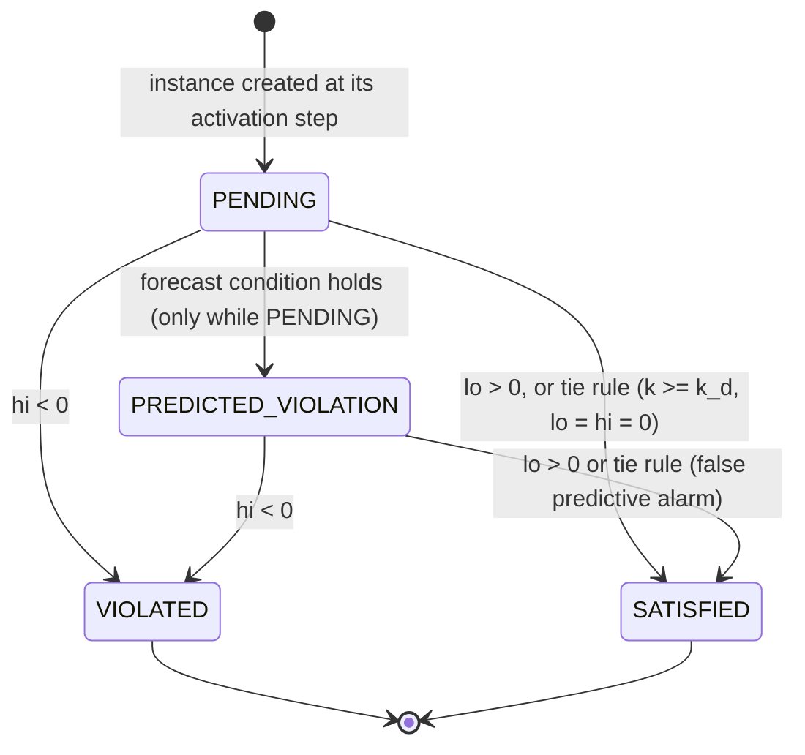

# 05 Three-valued online semantics with robustness intervals and latency bounds

Document WS01-T05. Feeds paper Section IV-C (the monitoring half; Proposition 1 comes from WS01-T06), the monitor core of WS05-T04 and WS05-T08, the ablations A2 and A7 (WS08-T03) and the verdict part of the worked day of WS01-T08. Draft for the M1 freeze (WS01-T08); it changes no contract of `docs/plan/02-interfaces.md` (gaps and clarifications are recorded in section 11). It builds on `docs/formal/01-signals-sampling.md` (WS01-T01, called "T01" below: grid, ceiling rule, one instance per anchor, two clocks, day boundary; its gaps CG-1 to CG-14 and modelling choices M1 to M6 are respected and not overridden), on `docs/formal/02-templates.md` (WS01-T02, "T02": instance semantics, margin and guard rule, decision instants, future-time forms; its open points TG-1 to TG-14), on `docs/formal/03-parameter-registry.md` with `configs/registry/hypertension.yaml` (WS01-T03) and on `docs/formal/04-normalisation-ranking.md` (WS01-T04, "T04": normalisation, ranking, open points OP-1 to OP-16). Validation in this project is technical and pre-clinical; nothing in this document is a clinical claim. Every clinical number is either fixture arithmetic (FIXTURE-ONLY, fixture registry F0 of `docs/plan/workstreams/WS01-formalization/README.md`) or a value of analisi §4.1, §4.6 or §4.7 labelled "illustrative, unverified" (ADR-020); in particular the physiological bounds `bound_bp_lower` and `bound_bp_upper` are the example interval [50, 250] mmHg of analisi §4.7 and nothing else. The semantics is evaluated on the observed trace only: nothing in it reads `LatentDay` or `GroundTruthEvent`.

What this document answers (review items): R1 weakness 6 (the workshop Table I emits at 21:02 a cross-modal verdict that the declared semantics can decide only much later: sections 3, 7), R2 weakness 2 (measured values versus conformal envelope: sections 1, 5) and AE-5 (internal inconsistencies of Table I: sections 1 and 7).

**How the claims of this document are labelled.** A statement is called a *Lemma* only if the text gives its exact hypotheses and a proof written out step by step. Many statements are also *checked by a randomized test (not part of the repository)*: a reference implementation of the semantics written for this task in `/tmp` (a parser and interval evaluator of the grammar of T02 section 1.2, a device-time input model with the reorder buffer, direct per-template oracles, a brute-force enumerator of completions and a monitor simulation) was run on seeded random scenarios; the number of draws is stated with each claim. A test is never presented as a proof. A claim that a monitor cannot do better is a claim about the completion set of section 2.1 and is proved by an explicit witness (Lemma 6), not tested only.

**Conventions.** Time is integer milliseconds; the grid is `t_k = k * T_s`, `k = 0..K` (T01 section 3.1); an input with device time `t` is visible at step `k_up(t) = ceil(t / T_s)`; `D` is the reorder delay; `a` is the device time of the anchor of an instance, `k_a = k_up(a)`, `B` its deadline offset (T02 section 3.2), `k_d = k_a + B / T_s` its decision step and `t_d = t_{k_d}` its decision time. `sigma` is raw robustness in the unit of the template, `sigma_tilde = N_s(sigma) = clip(sigma / s, -1, 1)` (T04 section 2.1) normalised robustness; `[lo, hi]` is a raw robustness interval and `[N_s(lo), N_s(hi)]` its normalised image. "Robustness" is used only for STL semantics. The verdict states are PENDING, PREDICTED-VIOLATION (written PREDICTED_VIOLATION for the enum value `predicted_violation`), VIOLATED and SATISFIED. References are not cited from memory: where a reference would be needed the marker `[ref-needed: WS03]` is written, with the key of the entry of `paper/refs/references.bib` when one exists (every entry has `verified = {false}`, ADR-018, and none may be cited in the paper until a human verifies it).

## 1 Measured versus predicted

### 1.1 The two readings and the workshop contradiction

Analisi §4.3 finds two incompatible readings in Section II-B.c of the workshop paper.

- **Reading A, predictive monitoring.** A forecaster completes the future of the trace and conformal prediction bounds the error of the predicted robustness; the verdict is about the future.
- **Reading B, measurement uncertainty.** The verdict is about the measured value and conformal prediction has no role.

The workshop sentence that ties the flagging of a violation to the uncertainty envelope leaving the safe region adds a third problem: applied to measured values it suppresses true positives close to the threshold, which is the anti-conservative choice for safety (analisi §4.3, R2 weakness 2). The same text also says that final safety verdicts remain grounded in measured values. The two statements cannot both hold for one verdict.

### 1.2 The separation adopted (ADR-008)

The two channels are separated formally.

1. **Definitive verdicts come only from the measured prefix.** A definitive verdict (VIOLATED or SATISFIED) is a function of the prefix of accepted inputs, of the care plan and of the registry bounds, through the robustness interval of section 2. Unknown future values are completed by the physiological bounds of the registry, never by a forecast.
2. **Measurement uncertainty is not modelled by the forecaster.** A measured value is treated as the value of the signal. How far it can be trusted is the confidence `rho` of kind MEASURED, computed from a device error model (WS01-T06, analisi §4.4 first row), conditional on the adequacy of that model; silent faults that produce plausible values are not seen by it and belong to attribution (WS02). The verdict never uses an envelope: a measured value 0.2 mmHg beyond a limit is VIOLATED (with a `rho` close to one half), not suppressed.
3. **Conformal prediction acts only in PENDING and only for early warning.** A conformal completion of the forecast may move a record from PENDING to PREDICTED_VIOLATION (section 5). It never produces VIOLATED or SATISFIED and never changes a field of the interval (Lemma 9).

The sentence "final safety verdicts remain grounded in measured values" holds by construction: the state of a definitive record, its interval and its `decided_at_ms` are functions of the accepted measured prefix alone (Lemma 3 for the content, Lemma 9 for the independence of the forecaster), and the forecaster can be removed without changing any of them (ablation A2, analisi §5.6: "same definitive verdicts, no early warning"). The two channels therefore answer two different questions: the measured channel "does the prescribed care hold on the data received, whatever the future brings", the predicted channel "is it likely, with a stated marginal guarantee over patient episodes under exchangeability (Proposition 1, WS01-T06), that it will not".

| | Measured channel (sections 2 to 4) | Predicted channel (section 5) |
|---|---|---|
| Question | Does every completion of the unknown future satisfy (or violate) the template? | Is a violation likely, given a forecast? |
| Unknown future replaced by | physiological bounds, "event present or absent", counters from the known count to plus infinity | the forecaster's path, with a conformal margin |
| Output | robustness interval `[lo, hi]`; VIOLATED, SATISFIED or PENDING | PREDICTED_VIOLATION, only on a PENDING record |
| Guarantee | sound with respect to the measurement model (Lemma 3), nothing probabilistic | marginal over patient episodes under exchangeability (Proposition 1, WS01-T06) |
| Uncertainty enters | `rho` of kind MEASURED (device error model) | `rho` of kind PREDICTED (`1 - alpha*`) |
| Removed by ablation | not removable | A1 (conformal replaced by a point forecast) and A2 (forecaster removed) |

### 1.3 Relation to prior work

The robustness interval on a partial trace, with unknown future values replaced by bounds, follows the pattern of online monitoring with robustness intervals on partial traces (`deshmukh-online-monitoring-conf`, analisi §3.1, §4.7 step 2) and the three-valued verdict follows three-valued monitoring semantics (`bauer-leucker-schallhart-three-valued`, same sources); both entries are `recalled` and unverified (ADR-018) and are described here only as far as analisi describes them. What this document adds is the specification-level use: the instance semantics of T02 (obligations anchored at events, decided at a deadline), the treatment of unavailable evidence channels (section 3.5) and the separation of the measured and the predicted verdict. Against conformal STL runtime verification on dense predicted trajectories (`lindemann-conformal-stl`, the closest published work according to analisi §3.2 and the baseline B5), the element of difference that belongs to this document is the formal separation of the verdict on measured data from the predictive verdict, with conformal prediction confined to PENDING (docs/related-work/conformal-predictive-monitoring.md, difference sentence, element 2; ADR-008). Hedge that travels with it: the characterisation "dense predicted trajectories" is taken from analisi §3.2, which recalls the paper from memory; it has not been checked against the paper text (WS03-T06), and no priority claim is made.

## 2 Robustness intervals on prefixes

### 2.1 Prefix, positions and completions

**Accepted trace.** An input is *accepted* if it is not late and not future-stamped (T01 sections 4.2 to 4.4): it is received at or before the watermark `t_{k_up(t_dev)} + D` of its step and its device time does not exceed its receive time by more than `skew_max` (M4). The accepted inputs form the *accepted trace* `omega_acc`. Whether an input is accepted depends on that input alone (its two clocks, `D`, `T_s`), not on when `advance` is called, provided lateness is decided from the arrival time as T01 section 4.2 requires (requirement R-late, section 6.1). Late inputs are not part of the accepted trace: the step they would have occupied carries the absence of the event.

**Positions.** A *position* is a pair `(x, j)`: a signal `x` (including the derived and per-instance terms of T01 section 5) at a step `j`. Its grid value is defined by T01 sections 3.2 to 3.5: a real number, `NaN` (held signal before its first sample) or `None` (channel unavailable). Let `P_k` be the *prefix at step k*: the accepted inputs with step `<= k` together with the availability masks of the steps `<= k`. A position is

- *determined* in `P_k` if `j <= k` and its grid value is a real number (an available impulse channel with no event in the step is determined, with value 0);
- *future-open* if `j > k`: this includes every step whose inputs are still inside the reorder window, because an input with step `> k` is not used at step `k` (causality, Lemma 1);
- *stale-open* if `j <= k` and its grid value is `NaN` or `None`: a held signal before its first sample, a robot channel that was unavailable, or the captured pre-dose value `pre_i` when no pressure sample precedes the dose (T01 section 5.3). Later inputs cannot determine a stale-open position, because the grid value at step `j` depends only on inputs of steps `<= j`.

**Domains.** Every open position has a domain of values it may take:

| Position | Domain | Origin |
|---|---|---|
| pressure `bp` (held value, or a measurement value, or the captured `pre_i`) | `[bound_bp_lower, bound_bp_upper]` (F0: `[50, 250]` mmHg, illustrative, unverified) | registry bounds, analisi §4.7 step 2 |
| indicator or status (`meas`, `dispense`, `intake`, `sched_tick`, `auth`, `presence`, `cuff_health`) | `{0, 1}`; "any future step may or may not carry an event" | structural |
| event multiplicity of a step (counters) | the non-negative integers, no upper bound | structural; no registry bound (decision of section 2.7 and open point OP-T05-5) |
| `inflation_ms` | `[0, +inf)` | a duration is non-negative; no registry bound |

**Completion.** A *completion* of `P_k` is a total assignment of values, each in its domain, to the open positions, with the determined positions as in `P_k`; derived terms are computed from the assigned basic positions by the definitions of T01 section 5 (`dose_count` is the sum of the multiplicities in its 24 h window, `bp_drop = pre_i - bp`). `Comp(P_k)` is the set of completions. It contains, for the future, every possible continuation: any step may or may not carry an event, a measurement may carry any pressure of its domain, any number of dispenses may occur; the data still inside the reorder window are unknown; the values of unavailable and undefined positions are arbitrary.

**Hypotheses used by the lemmas.** Each lemma lists those it needs.

- (H-grid) Window parameters are non-negative integer multiples of `T_s`, `T_s` divides `T_day` (T01 section 3.6, M2); anchors are read at `k_up(a)`, `k_d = k_a + B / T_s`; `k_d <= K` unless stated (an instance whose decision step lies after the closing step is decided early where the early-decision rule of section 3.3 applies and is otherwise PENDING at trace end, section 7.5, Lemma 12b).
- (H-inst) One instance per anchor event (T01 section 3.7), the pre-dose value is captured per instance (T01 section 5.3), the per-instance value is evaluated by the reference semantics of T02 section 1.5.
- (H-acc) The acceptance rule above.
- (H-dom) Every pressure of the accepted trace, past and future, lies in the domain `[bound_bp_lower, bound_bp_upper]`; equivalently `omega_acc` is a completion of `P_k` for every `k` (so the actual trace is among the completions the monitor reasons about). It is needed by Lemma 4 (nesting, the rule-1 verdict being absorbing, monotone `hi`) and by what rests on it (Lemma 8, the VIOLATED statements of Lemmas 7 and 12), and by Lemma 3 only when it is read as a statement about the actual trace. Section 2.5 shows what fails without it and what the monitor still keeps by construction.
- (H-pair) The pressure sample, the cuff health and the inflation of an accepted measurement event are accepted with it (the event and the sample of one measurement travel together). If a sample is missing, the grid value read at `k_a` is that of the latest earlier sample when one exists: a determined, possibly out-of-date number, so the monitor then decides on an old pressure and the interval is narrower, not wider (stale input is a matter for attribution, WS02, not an open position). Only when no earlier sample exists is the position stale-open and the interval wider (the RANGE example under Lemma 3). The closed forms of section 2.3 and Lemma 10 do not need (H-pair): they carry the open case. Checked by a randomized test (not part of the repository; 20,000 seeded draws of RANGE events with the pressure sample dropped at random): 14,226 of 14,226 events with an earlier sample give a point interval, 9,386 of 9,998 events without one give `[-110, 90]` (F0 band `[110, 140]`; the others read the held value of a later sample of the same bin).
- (A0) At most one pressure sample per bin `(t_{k-1}, t_k]`, and, for SYS, at most one `cuff_health` sample and one `inflation_ms` sample per bin. This is stronger than the (A0) of T02 section 1.5, which is stated for measurement events ("at most one measurement event per bin"). The grid keeps one sample per bin (T01 section 3.4), so an instance of RANGE or SYS reads the last sample of its bin; T02's reference semantics reads the payload of the instance's own event. Under (H-pair) every event carries its own samples, so the two coincide when the samples of the bin are those of one event and of nothing else: a second event in the bin is excluded, and so is a standalone sample (a `bp`, `cuff_health` or `inflation_ms` sample that belongs to no event) with a later device time than the event's own, which replaces the held value of the bin although the instance of the event still reads its own payload in T02. With either, this document computes the grid value for the instances of the bin (a documented refinement, section 3.6 and open point OP-T05-12), not T02's per-event value.
- (H-hist) The accepted trace contains the history on which the windows depend: the first day of the patient (known empty history) or a carried-over warm-up prefix (T01 section 5.5, item 4). A run that starts with an empty state although earlier history exists violates it (section 11, CP7).
- (H-fin) Term intervals have a finite lower endpoint (their upper endpoint may be `+inf`): durations, counts, ages, pressures. Then no difference of two infinities arises (section 2.2).

### 2.2 The interval recursion

Extended reals `R* = R union {-inf, +inf}`; an *interval* is `[lo, hi]` with `lo <= hi` in `R*`. The robustness interval of an instance at step `k` stands for the infimum and the supremum of its raw robustness over the completion set `Comp(P_k)`; the monitor computes it by structural recursion with interval arithmetic, which gives an enclosure of that range (Lemma 3) and equals it for the instance bodies of the library (Lemma 6). The robustness interval `I(psi, j)` of a formula `psi` of the grammar of T02 section 1.2 at a step `j` of the prefix `P_k` is defined by structural recursion. Atoms use the interval of the value of their positions: a determined position gives the point interval of its value, an open position the interval hull of its domain (`[0, 1]` for `{0, 1}`, `[bound_bp_lower, bound_bp_upper]` for a pressure, `[0, +inf)` for a multiplicity). `age` is the point `(r - j) * T_s` with `r` the evaluation reference of T02 section 1.4 (for the instance bodies of section 2.3, `r = k_d`).

| Node | Computed interval |
|---|---|
| indicator `u`, value interval `[vl, vh]` | `[+inf if vl = 1 else -inf, +inf if vh = 1 else -inf]` (T02 section 1.3: `+inf` when true, `-inf` when false) |
| equality `x == c` on a status signal | `[+inf, +inf]` if `vl = vh = c`; `[-inf, -inf]` if `c` is outside `[vl, vh]`; `[-inf, +inf]` otherwise |
| margin `e1 >= e2`, term intervals `[l1, h1]`, `[l2, h2]` | `[l1 - h2, h1 - l2]`; `e1 <= e2` is `[l2 - h1, h2 - l1]` |
| `not f` | `[-hi, -lo]` (negation swaps the ends) |
| `f and g` | `[min(lo_f, lo_g), min(hi_f, hi_g)]` |
| `f or g` | `[max(lo_f, lo_g), max(hi_f, hi_g)]` |
| `f -> g` | `[max(-hi_f, lo_g), max(-lo_f, hi_g)]` |
| `once[a,b] f` at step `j` | `[max of lo, max of hi]` of `f` over the steps of the window `W(j, [a, b])` of T02 section 1.3; the empty maximum is `[-inf, -inf]` |
| `historically[a,b] f` | `[min of lo, min of hi]` over the same window; the empty minimum is `[+inf, +inf]` |
| `f since[a,b] g` | `max` over `i` in the window of `min(g_i, min over t in (i, j] of f_t)`, applied to the lower and to the upper endpoints separately; empty window `[-inf, -inf]` |
| term `dose_count` at step `j` | `[sum of the known multiplicities, +inf]` if an unknown multiplicity is in its 24 h window, else the point count |
| term `bp_drop = pre_i - bp` | `[pre_lo - bp_hi, pre_hi - bp_lo]` |

All operators of the recursion are `min`, `max`, negation, and one sum or difference at an atom. Three remarks.

1. **Empty maximum.** The maximum over an empty window is `-inf` (no witness), the minimum over an empty window is `+inf` (no counter-example), as in T02 section 1.3. A failed guard is a `-inf`.
2. **Well-definedness (H-fin).** In `l1 - h2` the first term is finite and in `h1 - l2` the second is finite, because every term interval has a finite lower endpoint; so a difference `inf - inf` never arises and `NaN` is never produced. `lo <= hi` is preserved by every row (each operator is monotone in the endpoints in the right direction). Checked: `lo <= hi` and no `NaN` at every one of 2,446,955 (instance, step) pairs of the in-domain test of Lemma 4 and of 2,443,575 pairs of the test with pressures outside the bounds (20,000 seeded draws each).
3. **Infinite endpoints (CP12).** `lo = -inf` arises from a failed guard or from "no event may come" (V-SCHED-1), `hi = +inf` from an unbounded counter (V-COUNT-3), `hi = -inf` from a closed instance whose guard failed (V-RESP-5). Normalisation maps `+-inf` to `+-1` (T04 section 2.4: `normalise(-inf, s) = -1.0`, `normalise(+inf, s) = +1.0`); the `sigma_norm_interval` of a record is `(N_s(lo), N_s(hi))` (T04 Lemma 3, corollary) and is finite. The raw interval keeps its infinite endpoints. Serialisation (required, because the JSON of the standard library does not encode infinities portably): in JSON the strings `"-inf"` and `"inf"`, in YAML `-.inf` and `.inf` (the golden file uses the YAML form); a loader that finds an infinity must not read it as a large finite number. `NaN` is never serialised (it never occurs).

### 2.3 Instance bodies, closing step and graded lateness

The monitor evaluates the instances of T02 section 1.5. For an instance `i` anchored at `k_a` with decision step `k_d`, its **body** `C_i` is the consequent of the template, evaluated by the recursion at the **closing step** `H_i >= k_d` on the prefix `P_k`. Its interval at step `k` is `I_i(k) = I(C_i, H_i)` on `P_k`. The per-instance terms are those of T02: `age_i(j) = (k_d - j) * T_s` (negative for `j > k_d`, the graded lateness of T02 section 2.3), `pre_i`, `r_i(j) = pre_i - bp_j`.

| Template | Body `C_i` | Evaluated at `H_i` | Positions it reads | Parameters (F0 values: window parameters in ms) |
|---|---|---|---|---|
| RANGE | `bp >= bp_band_low and bp <= bp_band_high` | `k_a` | `bp` at `k_a` | `bp_band_low`, `bp_band_high` |
| SCHED | `once[0, H_i - k_a] (meas and age >= 0)` with the signed `age_i` | `H_i = max(k_d, min(k_next, K))` | `meas` at the steps of `[k_a, H_i]` | `sched_window` (unset in `hypertension.yaml`; F0 1800000) |
| HOLD | `once[0, hold_lookback] meas and bp >= bp_hold_threshold` (refined form, T02 section 4.3) | `k_a` | `meas` over `[k_a - hold_lookback / T_s, k_a]`, `bp` at `k_a` | `hold_lookback`, `bp_hold_threshold` |
| COUNT, limit | `dose_count <= dose_max_24h` | `k_a` (the dispense step) | `dose_count` at `k_a` | `dose_max_24h` |
| COUNT, day end | `dose_count >= dose_min_day_end` | `K` | `dose_count` at `K` | `dose_min_day_end` |
| RESP | `once[0, delta2 - delta1] (meas and bp_drop >= delta_resp)` | `k_d = k_a + delta2 / T_s` | `meas`, `bp` over `[k_a + delta1 / T_s, k_d]`, and `pre_i` | `delta1`, `delta2`, `delta_resp` |
| SYS | `cuff_health == 1 and inflation_ms >= cuff_inflation_min` | `k_a` | `cuff_health`, `inflation_ms` at `k_a` | `cuff_inflation_min` |
| INT | `once[0, inf] ((presence or intake or auth) and age <= int_window)` | `k_a` | `presence`, `intake`, `auth` over `[0, k_a]` | `int_window` |

`k_next` is the visible step of the next tick of the same schedule (T02 section 2.3: the grading ends at the next tick of the schedule or at the closing step; `H_i = k_d` for every template other than SCHED). The unbounded `once` of INT is truncated at the first known step (step 0 of the day, or the start of the carried history, section 11 CP7). Only SCHED has `H_i > k_d`. The graded body of SCHED differs from the decision-step body of T02 (`once[0, sched_window] (meas and age >= 0)` evaluated at `k_d`) only by the extension of the window beyond `k_d`, where `age_i` is negative; Lemma 5 shows that the sign, hence the Boolean verdict, is the same.

**Closed forms.** Unrolling the recursion for the bodies above gives the following intervals at step `k >= act_i` (`act_i = k_a`, except `act = 0` for the day-end instance, which exists from the start of the day). They are derived below and are checked against the recursion by test (Lemma 10). They are stated **without (H-pair)**: a pressure position that is open (stale-open: the held signal has no sample at or before the step, for example an accepted measurement event whose pressure sample was lost with no earlier sample; or future-open) is given by its domain, through the following notation, so that the same rows cover the determined and the open case and no row has a hidden condition. For the pressure at a step `j` write `bp_lo(j) = bp_hi(j) = bp_j` if the grid value `bp_j` is determined and `bp_lo(j) = bound_bp_lower`, `bp_hi(j) = bound_bp_upper` if it is open; for the captured pre-dose value write `q_lo = q_hi = p` if `pre_i = p` is determined and `q_lo = bound_bp_lower`, `q_hi = bound_bp_upper` if it is stale-open. When the sample of an accepted measurement is lost and an earlier sample exists, the grid value at `k_a` is the held value of that earlier sample (determined, possibly out of date, section 2.1, (H-pair)): the rows then give the point of the old value; they give the hull of the domain only when no sample exists at or before the step.

| Template | `lo` | `hi` |
|---|---|---|
| SCHED | `s(j0)` if an accepted measurement exists at a step of `[k_a, min(k, H_i)]`, `j0` the earliest, `s(j) = (k_d - j) * T_s`; else `-inf` | `s(j0)` if `j0` exists; else `s(k + 1) = (k_d - k - 1) * T_s` if `k < H_i`; else `-inf` |
| RESP | `M_lo`, the maximum over the accepted measurements at steps `j` of `[k_a + delta1 / T_s, min(k, k_d)]` of `q_lo - bp_hi(j) - delta_resp` (`-inf` if none) | `max(M_hi, q_hi - bound_bp_lower - delta_resp)` if `k < k_d`; `M_hi` if `k >= k_d`, with `M_hi` the same maximum of `q_hi - bp_lo(j) - delta_resp` (`-inf` if none) |
| RESP, `pre_i` determined (`p`) | `M`, the maximum of `p - bp_j - delta_resp` (`-inf` if none) | `max(M, p - bound_bp_lower - delta_resp)` if `k < k_d`; `M` if `k >= k_d`; here `bp_j` is determined at every step `j >= k_a`, because the sample that gave `pre_i` precedes the dose, so `M_lo = M_hi = M` |
| RESP, `pre_i` stale-open | `M_lo` with `q_lo = bound_bp_lower`; a measurement step with a determined `bp_j` contributes `bound_bp_lower - bp_j - delta_resp`, one with an open `bp_j` contributes `bound_bp_lower - bound_bp_upper - delta_resp` | `M_hi` with `q_hi = bound_bp_upper`; a measurement step with a determined `bp_j` contributes `bound_bp_upper - bp_j - delta_resp`; the term for the unknown steps is `bound_bp_upper - bound_bp_lower - delta_resp`, and an open `bp_j` at a measurement step contributes the same value |
| INT | `int_window - (k_a - j_c) * T_s`, `j_c` the last step `<= k_a` with a determined witness (`auth`, or `presence` or `intake` determined to 1); `-inf` if none | the same with `j_p`, the last step `<= k_a` with a possible witness (a determined witness, or an open `presence` or `intake` position); `-inf` if none |
| COUNT, limit | `dose_max_24h - c_d(k_a)` | the same (point) |
| COUNT, day end | `c_today(k) - dose_min_day_end`, `c_today(k)` the number of accepted dispenses of steps `1..k` | `+inf` if `k < K`; the same as `lo` if `k = K` |
| HOLD | `-inf` if no measurement in the look-back window, else `bp_lo(k_a) - bp_hold_threshold` | `-inf` if no measurement in the look-back window, else `bp_hi(k_a) - bp_hold_threshold` (a point when `bp_{k_a}` is determined; with `bp_{k_a}` open, `[bound_bp_lower - bp_hold_threshold, bound_bp_upper - bp_hold_threshold]`, marker `value_undefined:bp`) |
| RANGE | `min(bp_lo(k_a) - bp_band_low, bp_band_high - bp_hi(k_a))` | `min(bp_hi(k_a) - bp_band_low, bp_band_high - bp_lo(k_a))` (a point when `bp_{k_a}` is determined; with `bp_{k_a}` open this is the enclosure of the remark under Lemma 3, `[-110, 90]` for the F0 band, not the exact range) |
| SYS | `min(G_lo, i_lo - cuff_inflation_min)` with `G_lo = +inf` if `cuff_health(k_a)` is determined to 1, else `-inf`, and `i_lo` the determined `inflation_ms(k_a)`, or `0` if it is open | `min(G_hi, i_hi - cuff_inflation_min)` with `G_hi = -inf` if `cuff_health(k_a)` is determined to 0, else `+inf`, and `i_hi` the determined `inflation_ms(k_a)`, or `+inf` if it is open; under (H-pair) both positions are determined and the interval is the point `min(+inf if cuff_health = 1 else -inf, inflation_ms - cuff_inflation_min)` |

Derivation, SCHED. At the closing step `H_i` the body is `max` over `j` in `[k_a, H_i]` of `min(meas_j, s(j))`, where `meas_j` is `+inf` or `-inf` and `s(j)` is the point `(k_d - j) * T_s`; so it is the maximum of `s(j)` over the steps with a measurement. A determined step contributes `s(j)` if it carries a measurement and `-inf` otherwise. An open step contributes `[-inf, s(j)]` (the indicator is `[-inf, +inf]`). Taking the maximum: the lower endpoint is the maximum over the determined measurement steps; the upper endpoint is the maximum of that and `s(j)` over the open steps `k + 1..H_i`; `s` is strictly decreasing in `j`, so the largest `s` of an open step is `s(k + 1)`, and it exceeds `s(j0)` never, because `j0 <= k < k + 1`. Derivation, RESP: the same with the term `r_i(j) - delta_resp` in place of `s(j)`; the largest value of an open measurement step is attained at the smallest pressure of the domain, `p - bound_bp_lower - delta_resp`. A step `j <= k` with an accepted measurement has `meas_j = +inf` and contributes the interval of its margin atom, `[q_lo - bp_hi(j) - delta_resp, q_hi - bp_lo(j) - delta_resp]` (a point when `pre_i` and `bp_j` are determined); a step `j <= k` without a measurement contributes `-inf` whatever `bp_j` is. Derivation, HOLD and RANGE: all the steps of the look-back window are `<= k_a` and determined, so `once[0, hold_lookback] meas` is `+inf` if a measurement is accepted in it and `-inf` otherwise, and the body is the minimum of this and the margin atom `bp >= bp_hold_threshold`, whose interval is `[bp_lo(k_a) - bp_hold_threshold, bp_hi(k_a) - bp_hold_threshold]`; RANGE is the minimum of the atoms `bp >= bp_band_low`, `[bp_lo - bp_band_low, bp_hi - bp_band_low]`, and `bp <= bp_band_high`, `[bp_band_high - bp_hi, bp_band_high - bp_lo]`, which share the position `bp` (not tight when it is open). Derivation, INT: `witness_j` is `+inf` at a determined witness, `-inf` at a determined absence, `[-inf, +inf]` at an open position; the margin `int_window - age` is largest for the most recent step; the maximum over `j` of `min(witness_j, margin_j)` is therefore the margin of the most recent determined witness for `lo`, and of the most recent possible witness for `hi`. Derivation, day end: `dose_count(K)` is the sum of the multiplicities of the steps `1..K`; the determined ones add their count to both endpoints, the open ones add `[0, +inf)`. Derivation, SYS: the body is the minimum of an equality atom on `cuff_health` and a margin on `inflation_ms`, two distinct positions occurring once each, so the interval is the minimum of the two atom intervals (equality atom: `[-inf, +inf]` if open, the point `+inf` or `-inf` if determined; margin: `[i_lo - c, i_hi - c]`).

**Worked check with F0.** V-SCHED-1 (tick 09:00, `k_a = 540`, `k_d = 570`, evaluation step 550, no measurement): `lo = -inf`, `hi = s(551) = (570 - 551) * 60000 = 1140000` ms, normalised `(-1, 0.6333)`. V-RESP-2 (`pre_i = 150`, one measurement of 145 at 08:30, evaluation step 510): `M = 150 - 145 - 10 = -5`, `hi = max(-5, 150 - 50 - 10) = 90`: `[-5, 90]`, normalised `(-0.25, 1)`. The 24 golden cases of section 9 were all reproduced by the reference implementation (24 of 24).

### 2.4 Lemmas on the interval

**Lemma 1 (causality of the prefix).** *Hypotheses:* (H-acc). *Statement:* (a) The prefix `P_k` is determined by the inputs received no later than the monitor time `t_k + D`; an input received later whose step is `<= k` is late and is not in any prefix. (b) For `k <= k'`, `P_{k'}` extends `P_k`: every accepted input of step `<= k` is in `P_{k'}`, every position determined in `P_k` is determined in `P_{k'}` with the same value, and every position open in `P_{k'}` is open in `P_k`. (c) Consequently every record computed at step `k` is a function of the inputs received by `t_k + D`, and no input that arrives after `t_k + D` changes it.
*Proof.* (a) An input `x` with `step(x) <= k` is accepted iff `t_rx(x) <= t_{step(x)} + D`, which implies `t_rx(x) <= t_k + D`; so all accepted inputs of steps `<= k` have been received by `t_k + D`, and acceptance is decided by comparing the two clocks of `x` with `t_{step(x)} + D`, which needs nothing received later; an input of step `<= k` that arrives after `t_k + D` has `t_rx > t_k + D >= t_{step(x)} + D`, so it fails the test and is late. (b) By the definition of the grid value (T01 sections 3.2 to 3.5: the value at step `j` is a function of the accepted inputs of steps `<= j`), a position with `j <= k` has the same grid value in `P_k` and in `P_{k'}`; determined remains determined; a position open in `P_{k'}` is stale-open (`j <= k'`, `NaN` or `None`) or future-open (`j > k'`), and in `P_k` it is stale-open if `j <= k` and future-open otherwise. (c) follows from (a) and from the fact that the recursion reads only the positions and the registry. ∎
*Checked by a randomized test (not part of the repository):* 40,000 seeded scenarios (up to 5 measurements with their cuff health and inflation samples, 3 dispenses, presence, intake and authentication inputs, 0 to 2 schedule ticks, random reorder delay and random transmission delays, so that 82,650 inputs were late), at a random step `k`: the intervals of all instances at all steps `<= k` are identical when all inputs with device time after `t_k` are removed, and when they are replaced by arbitrary others (13,492,709 comparisons, 0 differences); a mutant that reads one step of the future is caught (995 failing checks in a run of 3000 draws); a mutant that accepts late inputs is caught (6240 failing checks in a run of 3000 draws). The acceptance rule of this lemma, with lateness decided from the arrival time as in section 6.1, was checked in a streaming simulation of `push` and `advance` with random advance patterns and arrival times on and next to the watermark (20,000 draws, section 6.1): 0 differences from the rule of T01 section 4.2.

**Lemma 2 (inclusion isotonicity).** *Hypotheses:* (H-fin). *Statement:* if the interval of every atom is replaced by a sub-interval, the computed interval `I(psi, j)` of every sub-formula is replaced by a sub-interval (`[lo', hi'] ⊆ [lo, hi]`), and if every atom interval is a point the computed interval is the point robustness of T02 section 1.3.
*Proof.* By induction on `psi`. The endpoints of an atom are monotone in the endpoints of the value intervals. Indicator: `[f(vl), f(vh)]` with `f` non-decreasing, so a sub-interval `[vl', vh'] ⊆ [vl, vh]` gives `f(vl') >= f(vl)` and `f(vh') <= f(vh)`. Margin `e1 >= e2`: for sub-intervals `l1' >= l1`, `h1' <= h1`, `l2' >= l2`, `h2' <= h2`, hence `l1' - h2' >= l1 - h2` and `h1' - l2' <= h1 - l2`; the margin `e1 <= e2` is `[l2 - h1, h2 - l1]`, treated the same way. Equality: the three outcomes are ordered by inclusion. For `min`, `max` and the window operators the lower (upper) endpoint of the result is `min` or `max` of lower (upper) endpoints of the arguments, which are non-decreasing in each argument: if `lo'_f >= lo_f` and `lo'_g >= lo_g` then `min(lo'_f, lo'_g) >= min(lo_f, lo_g)`, and similarly for the upper endpoints with `<=`. For negation `[-hi, -lo]`: `-hi' >= -hi` and `-lo' <= -lo`. For `->`, `max(-hi_f, lo_g)` is non-decreasing in `-hi_f` and `lo_g`. The empty-window constants do not depend on the intervals. For points, `lo = hi` at every atom, hence at every node (each row maps a pair of points to a point equal to the T02 value). ∎

**Lemma 3 (soundness).** *Hypotheses:* (H-fin) and the definition of the completion set of section 2.1. *Statement:* for every completion `omega` of `P_k`, every sub-formula `psi` and every step `j`, the robustness `sigma(psi, j; omega)` (T02 section 1.3, on the complete trace `omega`, with the per-instance terms of section 2.3) lies in the computed interval `I(psi, j)`. In particular `V_i(omega) in I_i(k)` for every instance `i` and every `omega` in `Comp(P_k)`. Hence: if `hi < 0`, every completion violates (`V_i < 0`); if `lo > 0`, every completion satisfies (`V_i > 0`). Under (H-dom) the accepted trace `omega_acc` is one of the completions, so `V_i(omega_acc) in I_i(k)`.
*Proof.* By induction on `psi`. *Atoms.* In `omega` the value of each position lies in the interval used by the recursion: a determined position has the same value and a point interval; an open position has a value in its domain and the recursion uses the hull of the domain. An indicator atom has the robustness `+inf` or `-inf` according to the value (T02 section 1.3); the map from the value to the robustness is non-decreasing, so for a value in `[vl, vh]` the robustness is in `[f(vl), f(vh)]`, the computed interval. For a margin, the robustness is `e1 - e2` (or `e2 - e1`) for values of the terms in their intervals, and `x - y` with `x in [l1, h1]`, `y in [l2, h2]` lies in `[l1 - h2, h1 - l2]`. Equality atoms: if `vl = vh = c` the value is `c`; if `c` is outside the hull the robustness is `-inf` for every value; otherwise the interval `[-inf, +inf]` contains both outcomes. A shared position (the pre-dose value `pre_i` occurs in every step of the RESP window; `bp` occurs in two atoms of RANGE) needs no independence argument: each atom occurrence is bounded by the interval of its own positions, and that interval contains the value of `omega`. *Operators.* `min`, `max` are non-decreasing in each argument; negation is non-increasing; therefore, if each argument value lies in its computed interval, the value of the result lies between the result built from the lower endpoints and the result built from the upper endpoints, which are the computed endpoints. A window operator is `max` or `min` over the same finite set of steps for `omega` and for the recursion (the set depends only on `j` and the aligned parameters), so the same argument applies; an empty window gives the same constant. `since` is a composition of the operators already treated. The instance statement is the case `psi = C_i`, `j = H_i`. For the consequence: `hi < 0` gives `V_i(omega) <= hi < 0`; `lo > 0` gives `V_i(omega) >= lo > 0`. ∎
*Interval arithmetic is not claimed tight when a position occurs twice in a formula.* The enclosure can be strictly larger than the exact range `R_i(k) = [inf over Comp of V_i, sup over Comp of V_i]` (soundness holds, tightness is lost). Example (fixture arithmetic, band `[110, 140]` of F0): RANGE on a measurement event whose pressure sample was not accepted (the event is accepted, the sample is late and no earlier pressure sample exists, so the pressure position is stale-open; with an earlier sample the held value is determined and the interval is the point of that older value, (H-pair)): the body `bp >= 110 and bp <= 140` gives `[min(50 - 110, 140 - 250), min(250 - 110, 140 - 50)] = [-110, 90]`, but the exact range over the domain is `[-110, 15]` (`min(bp - 110, 140 - bp)` is largest, 15, at `bp = 125`); the enclosure `hi = 90` over-states what any completion can reach. Tightness for the bodies of the library is Lemma 6 and does not extend to arbitrary formulas.
*Checked by a randomized test (not part of the repository):* for the bodies SCHED, RESP, INT and the day-end COUNT, 200,000 seeded draws of (scenario, instance, step `k`) (SCHED 43,298, RESP 38,450, INT 38,892, day end 79,360 draws): every completion of the open positions in the dependence window of the instance was evaluated by a direct per-template oracle, exhaustively when the number of completions was at most 700 (127,725 draws) and otherwise on 350 random completions plus explicit extremal ones; ties at zero are frequent (1,437,987 completions with value exactly 0); 0 completions outside `[lo, hi]`. The same with arbitrary decimal pressures (floating point values with three decimals), 150,000 draws (SCHED 32,540, RESP 28,694, INT 29,169, day end 59,597): 0 completions outside. A mutant with a wrong lower pressure bound (60 instead of 50) is caught (10,161 failing checks in a run of 3000 draws).

**Lemma 4 (stability).** *Hypotheses:* (H-fin), (H-dom); `k <= k'` are steps of the same run, both `>= act_i`. *Statement:* (a) `I_i(k') ⊆ I_i(k)` for every instance `i`: intervals computed on a longer prefix are contained in those of a shorter prefix. (b) The verdict rule of section 3.1, applied afresh at each step, is absorbing: if the rule gives VIOLATED (SATISFIED) at `k`, it gives VIOLATED (SATISFIED) at every `k' >= k`; the two definitive states exclude each other. (c) The first step at which the rule gives a definitive state, `k*_i`, is well defined, and `decided_at_ms = t_{k*_i}` does not depend on later steps. (d) `hi` is non-increasing and `lo` non-decreasing in `k`, so the certified normalised value `N_s(hi)` of a VIOLATED record is non-increasing in `k`: it can only become more severe. *Without (H-dom) (a), (b) and (d) are false* (section 2.5, with a counterexample); the monitor of section 6.2 does not apply the rule afresh to a definitive instance, so its states are absorbing by construction, with or without (H-dom), and (c) holds for the machine (the first step at which the machine leaves PENDING is the first step at which the rule gives a definitive state). What the machine's records then carry is stated in section 2.5.
*Proof.* (a) By Lemma 1(b), a position determined at `k` is the same point at `k'`; a position that is open at `k'` is open at `k` with the same domain, hence the same interval hull. The remaining case is a position that is open (future-open) at `k` and determined at `k'`: the interval used at `k` is the hull of its domain and the interval used at `k'` is the point of its value, and the point lies in the hull exactly when the value lies in the domain, which for a pressure is (H-dom). (Without (H-dom) this is the step that fails: a measurement of 40 mmHg is a point outside the hull `[50, 250]`.) Derived intervals (`dose_count`, `bp_drop`) are sums and differences of such intervals, which are inclusion-isotone; the captured value `pre_i` is fixed from the anchor step on. Lemma 2 gives the inclusion for every node, in particular for the body. (b) Let `lo, hi` be the endpoints at `k` and `lo', hi'` at `k' >= k`, so `lo' >= lo` and `hi' <= hi` by (a). Case VIOLATED: `hi < 0` gives `hi' <= hi < 0`. Case SATISFIED by `lo > 0`: `lo' >= lo > 0`. Case SATISFIED by the tie rule (`k >= k_d`, `lo = hi = 0`): `0 = lo <= lo' <= hi' <= hi = 0`, so `lo' = hi' = 0` and `k' >= k >= k_d`. Exclusion: `hi < 0` and `lo > 0` contradict `lo <= hi`; the tie rule needs `hi = 0`, which contradicts `hi < 0`, and `lo = 0`, which contradicts `lo > 0`. (c) and (d) are immediate from (a) and (b). ∎
Under (H-dom) this is the property that makes the rule "an emitted definitive verdict is never retracted" of T01 (sections 3.7 and 4.3) a property of the interval rule itself: the late-sample policy cannot change a verdict (Lemma 1) and more data can only narrow an interval. Outside (H-dom) the rule "never retracted" is kept by the construction of the monitor, not by the intervals (section 2.5).
*Checked by a randomized test (not part of the repository), both regions reported.* Pressures inside the bounds (H-dom holds): 20,000 seeded scenarios, 220,708 instances (all seven templates), 2,446,955 (instance, step) pairs: the intervals are nested at every step (0 failures), the rule-1 verdict is absorbing in all (0 failures, 205,306 instances decided), the sticky state machine with a random forecaster (58,145 warnings) stays on the allowed graph of section 4 (0 violations). Pressures also outside the bounds (a generator that adds measurements of 20 to 49 and of 255 to 300 mmHg to the pool of values): 20,000 scenarios, 220,474 instances, 2,443,575 pairs: 3,354 nesting failures in 3,263 instances (all of them an increase of `hi`, none a decrease of `lo`, all RESP), 1,998 failures of absorption of the rule applied afresh (VIOLATED at an earlier step, not at a later one), and 1,998 records of the sticky machine that are VIOLATED while the interval of the record has `hi >= 0` (section 2.5); the machine itself never left the allowed graph (0 violations, 54,616 warnings).

**Lemma 5 (the graded value has the sign of the decision-step value).** *Hypotheses:* (H-grid), (H-inst). *Statement:* let `sigma_i^dec(omega)` be the value of the instance at its decision step as defined in T02 section 1.5 (the body of the template evaluated once at `k_d`), and `V_i(omega)` the value of the body of section 2.3. For a complete trace `omega`: (a) for every template other than SCHED, `V_i = sigma_i^dec`; (b) for SCHED, if `sigma_i^dec >= 0` then `V_i = sigma_i^dec`, and if `sigma_i^dec = -inf` (no measurement in `[k_a, k_d]`) then `V_i < 0` (a finite negative lateness or `-inf`). In particular `V_i >= 0` iff `sigma_i^dec >= 0`, and a tie `sigma_i^dec = 0` is a tie of `V_i`.
*Proof.* (a) `H_i = k_d`, same body. (b) `V_i = max` over `j in [k_a, H_i]` of `s(j)` at the measurement steps, `sigma_i^dec = max` over `j in [k_a, k_d]` (T02 section 1.5, the term `age >= 0` equals `s(j) >= 0` on that window), `H_i >= k_d`, `s` strictly decreasing and `s(j) < 0` for `j > k_d`. Case 1: a measurement exists in `[k_a, k_d]`. The earliest, `j0`, gives `sigma_i^dec = s(j0) >= 0`; the steps of `(k_d, H_i]` contribute values `< 0 <= s(j0)`, so `V_i = s(j0)`. Case 2: none exists in `[k_a, k_d]`: `sigma_i^dec = -inf`; the maximum for `V_i` is over steps `> k_d` only, each `s(j) <= -T_s < 0`, or `-inf` if none: `V_i < 0`. ∎
*Checked by a randomized test (not part of the repository):* 40,000 seeded complete scenarios (no open position; RESP instances with an undefined pre-dose pressure are excluded), 491,697 instance checks: the recursion on the complete trace equals the direct oracle value; the sign relation holds in all; for SCHED the graded value differs from the decision-step value in 8,393 instances, all with `sigma_i^dec = -inf`; the final verdict equals the Boolean value of `sigma_i^dec` (87,432 instances have `sigma_i^dec = 0`).

**Lemma 6 (tightness for the instance bodies).** *Hypotheses:* (H-fin), (H-inst), the completion set of section 2.1 as a product of the domains of the open positions, one pressure sample per measurement step. *Statement:* for the bodies SCHED (graded), RESP (with `pre_i` determined or stale-open), INT, COUNT (day end and limit), HOLD, SYS (also with an open `cuff_health` or `inflation_ms`), the computed interval equals the exact range `R_i(k) = [inf, sup]` of `V_i` over `Comp(P_k)`, and each finite endpoint is attained by a completion. For an infinite endpoint the exact range approaches it (a count of `n` further dispenses gives `c_today + n - dose_min_day_end`, unbounded in `n`; an inflation of `x` ms with `cuff_health = 1` gives `x - cuff_inflation_min`). RANGE with an open pressure position is not covered: `bp` occurs in two atoms (section 2.4, Lemma 3, example). SYS is covered because `cuff_health` and `inflation_ms` each occur once, so it is read-once.
*Proof.* A formula built by `min`, `max` and negation from atoms in which every open position occurs at most once ("read-once") is tight: by induction, the range of `min(f, g)` over disjoint sets of variables is `[min(inf f, inf g), min(sup f, sup g)]` because the infima and the suprema of `f` and `g` are attained independently; likewise for `max`; negation swaps the range; for an atom, the range of a monotone function of one position over its domain is attained at the endpoints of the domain. SCHED: the open positions are the `meas` indicators of the steps `k + 1..H_i`, one atom each; the witness completions are "no measurement at any open step" (value `lo`) and "a measurement at step `k + 1` only" (value `hi = s(k + 1)`, when `k < H_i` and no measurement is determined). RESP with `pre_i` determined: the open positions are `meas` and `bp` of the open window steps, once each; the witnesses are "no measurement" and "one measurement at an open step with the smallest pressure of the domain". RESP with `pre_i` stale-open: the position `pre_i` occurs in every term but every term is non-decreasing in it, so the infimum is attained at `pre_i = bound_bp_lower` and the supremum at `bound_bp_upper`, together with the independent choices of the other positions. INT: `presence`, `intake`, `auth` at distinct steps, once each; witnesses are "every open witness absent" and "every open witness present". Day end: the multiplicities of the open steps, once each, summed; the infimum is "no further dispense". SYS: `cuff_health` and `inflation_ms` occur once each, in different atoms; the infimum is attained at `cuff_health = 0` (value `-inf`) when it is open, otherwise at `inflation_ms = 0` (value `0 - cuff_inflation_min`) when it is open, and the supremum at `cuff_health = 1` with the largest value of the inflation (`+inf` is approached when `inflation_ms` is open). The B = 0 templates with every position determined are points. ∎
*Consequence.* No monitor that decides from the prefix and the completion set of section 2.1 can decide earlier than the computed interval allows: if `lo < 0` there is a completion that violates, so no sound SATISFIED; if `hi >= 0` there is a completion that satisfies (a tie is satisfied), so no sound VIOLATED; `lo = 0` is the tie case of section 3.4, where the Boolean value is satisfied for every completion but rule 1 (`lo > 0`) does not fire.
*Checked by a randomized test (not part of the repository):* in the draws of Lemma 3 (200,000 and 150,000 draws) the minimum and the maximum of the enumerated values equal `lo` and `hi` whenever `hi` is finite, and the minimum equals `lo` when `hi = +inf`: 0 failures. A mutant with `hi` one step too small is caught (14,602 failing checks in a run of 3000 draws). SYS, with each of `cuff_health` and `inflation_ms` dropped at random (H-pair violated; 20,000 seeded draws, 69,004 SYS instances, 15,666 with an open position): the interval equals the minimum and the maximum over an enumeration of the completions (`cuff_health` in `{0, 1}`, `inflation_ms` in `{0, 29, 30, 31, 45, 10^9}`; `+inf` approached, not attained) in all, 0 untight; the closed form of section 2.3 equals the recursion in all (0 differences).

### 2.5 Hypothesis (H-dom) and what fails without it

(H-dom) says that every pressure the monitor will ever accept lies in `[bound_bp_lower, bound_bp_upper]`. Lemma 3 is a statement about the completions; it applies to the actual trace only under (H-dom). Without it, three things fail.

1. **Nesting and monotone `hi` (Lemma 4(a), (d)).** The interval used for a future pressure is the hull of the domain; when the actual pressure arrives it is a point of the interval used before only if it lies in the hull. Outside the hull `hi` can increase.
2. **The interval rule is no longer absorbing (Lemma 4(b)).** Rule 1 applied afresh at each step can give VIOLATED at one step and PENDING or SATISFIED at a later one.
3. **A verdict that rested on a bound can be contradicted by the data.**

Counterexample (fixture arithmetic, F0, the three failures at once): a dispense at 07:00 with `pre_i = 55` (pressure 55 at 06:45): the largest drop a pressure in `[50, 250]` allows is `55 - 50 = 5 < delta_resp = 10`, so `hi = -5 < 0` and the RESP record is VIOLATED at the anchor step, `I(k_a) = [-inf, -5]`. A later measurement of 40 mmHg (outside the domain) at 08:30 gives the margin `55 - 40 - 10 = +5`, so `lo' = M = 5` and `hi' = max(5, 55 - 50 - 10) = 5`: `I(k') = [5, 5]` is not contained in `I(k_a)`, `hi` has increased from `-5` to `5`, rule 1 applied afresh gives SATISFIED, and the actual value is `+5`, a satisfied response (reproduced by the reference implementation). Counts over seeded random draws are in the test of Lemma 4: with pressures inside the bounds 0 failures in 2,446,955 pairs, with pressures also outside 3,354 nesting failures (all RESP, all an increase of `hi`) and 1,998 failures of absorption in 2,443,575 pairs.

**What the monitor keeps without (H-dom), by construction.** The loop of section 6.2 evaluates the guards only for an instance that is PENDING or PREDICTED_VIOLATION, so a definitive state is never re-evaluated: the state sequence is absorbing, `decided_at_ms` is the first step at which the rule gave a definitive state, the transitions are those of the contract, and Lemma 9 (independence of the forecaster) holds, whether or not the pressures are in the domain (0 failures in the out-of-domain test of Lemma 4: 20,000 draws, 220,474 instances). A definitive record already issued is therefore never retracted; this is a property of the machine, not of the intervals.

**Disclosed consequence, and an open point.** Contract rule 1 reads "VIOLATED iff `sigma_interval.hi < 0`". Out of (H-dom) the machine can emit, after the deciding step, a VIOLATED record whose interval has `hi >= 0` (in the example, `[5, 5]` at 08:30 on an instance that was VIOLATED at 07:00): the `only if` direction of rule 1 then fails for such a record, because the interval fields are those of the measured prefix and are not frozen at the deciding step. In 20,000 out-of-domain draws this happened for 1,998 records, and in 20,000 in-domain draws never. A SATISFIED record is not affected in the draws (0 records with `lo < 0` among the 20,000 out-of-domain draws): in the bodies of the library a future position enters `lo` only as `-inf`, so `lo` does not depend on the domain of a future pressure. This document does not decide how to treat it; it is recorded as open point OP-T05-13 for WS01-T08 (CP-style, a possible ADR): read rule 1 as "at the step where the verdict is first issued", freeze the interval fields of a definitive record at the deciding step (which would stop the SCHED refinement of section 6.5), or add an out-of-domain marker and keep the interval.

**Adopted.** The verdict is issued, as WS05-T04 test 8 expects; it is *sound with respect to the bounded measurement model*, and the dependence on the bounds is stated, not hidden. A sample outside the bounds is not a new case for the verdict: it is used as measured by every instance whose window it falls in, the definitive record already issued is not retracted (by construction of the monitor, section 6.2; not by Lemma 4, which needs (H-dom)), and the sample is evidence of implausibility (counted per source, handed to the attribution layer WS02). Which early verdicts rest on a bound is visible: only a record whose deciding endpoint is a finite `hi` or `lo` obtained from `bound_bp_lower` or `bound_bp_upper` does (RESP, with the lower bound in `hi` and the upper bound only with an open `pre_i`); WS05 may log it. An option that waits for the decision step instead (no early VIOLATED by bounds) trades latency for independence of (H-dom); it is left to WS01-T08 (section 11, OP-T05-8).

### 2.6 Floating point and exactness

Raw robustness values are integer-valued in `ms` and in doses (sums and differences of integer milliseconds below `2^53`, exact in IEEE 754 double arithmetic; one day is `8.64e7` ms) and real-valued in `mmHg` (pressures are floats). The following caveats are stated so that a test of WS05 does not assert more than the arithmetic gives. They follow the style of T04 section 2.3.

(a) *Monotone rounding.* The recursion uses only `min`, `max`, negation and, at an atom, one correctly rounded sum or difference, which is non-decreasing in each operand (non-increasing in the subtrahend). Lemma 2 and Lemma 3 therefore hold in floating point provided the endpoint of the interval and the value on a completion are computed by the same sequence of operations in the same order. Checked: 150,000 draws with arbitrary decimal pressures, 0 completions outside the interval and 0 untight endpoints (section 2.4).
(b) *The order of operations matters.* The margin of RESP is `(pre_i - bp) - delta_resp` (T02 order). Computing the bound as `pre_i - (bound_bp_lower + delta_resp)` instead can put `hi` one unit in the last place below the value of the completion with `bp = bound_bp_lower`, which breaks `value <= hi` (fixture arithmetic with hypothetical decimals: `pre = 68.82600838793651`, bound `47.5`, threshold `5.56` gives `(pre - 47.5) - 5.56 = 15.766008387936512` but `pre - (47.5 + 5.56) = 15.766008387936509`; in a seeded search of 3,000,000 such draws 536,761 had the second form below the first). WS05 must use the order of T02.
(c) *Zero.* The tie rule compares `lo == 0` and `hi == 0`; negative zero compares equal to zero, so `-0.0` does not change a verdict (`hi < 0` and `lo > 0` are false for it).
(d) *No NaN.* Python's `max(-inf, nan)` returns `-inf` silently; an implementation must assert that no `NaN` enters an interval (it cannot under (H-fin)).
(e) *Normalisation* is T04 (`N_s(+-inf) = +-1`, sign preserved; `-0.0` possible at underflow, T04 section 2.3 (a)); the verdict is always taken from the raw interval, never from the normalised one.

### 2.7 Registry bounds that this document needs, and does not need

The completion of unknown values uses `bound_bp_lower` and `bound_bp_upper` (seeded in the registry from analisi §4.7). It uses no registry bound for `dose_count` (the day-end interval has `hi = +inf`, V-COUNT-3) and none for `inflation_ms` (domain `[0, +inf)`): the unset names that WS01-T03 declared for them (T03 section 3.4, OP-8) are not needed by this semantics and can be removed by the next major version of the registry, a decision for WS01-T08 (section 11, OP-T05-5). The upper pressure bound `bound_bp_upper` is used by none of the golden cases; it enters only when `pre_i` is stale-open (closed forms, RESP) or when a pressure position of a RANGE or HOLD instance is open.

## 3 Three-valued verdict

### 3.1 The contract, restated, and the record function

The contract of `02-interfaces.md#verdict` (version 0.1.0, owner WS01) is quoted below; the differences from its text are listed after the quotation.

- `VerdictState`: `PENDING`, `PREDICTED_VIOLATION` ("early warning, never definitive"), `VIOLATED` ("definitive, from measured prefix only"), `SATISFIED` ("definitive, from measured prefix only").
- `RobustnessInterval(lo, hi)`: "raw robustness lower bound (native unit)" and "raw robustness upper bound; unknown future values replaced by physiological bounds".
- `VerdictRecord(instance_key, template, t_eval_ms, state, sigma_interval, sigma_norm_interval, rho, decided_at_ms, pending_until_ms)` with `sigma_interval` raw and in the native unit, `sigma_norm_interval` the clipped normalised interval, `rho: Rho | None`, `decided_at_ms` "when the definitive verdict became decidable; None while PENDING", `pending_until_ms` "deadline after which the verdict is definitive (anchor + Delta2 or W)".
- Semantics rule 1: VIOLATED iff `sigma_interval.hi < 0`; SATISFIED iff `sigma_interval.lo > 0`; otherwise PENDING. Rule 2: PREDICTED_VIOLATION is emitted only while PENDING, when the conformal completion satisfies `sigma_hat + q_{1-alpha} < 0` ("likely") or `sigma_hat - q < 0` ("possible"); which one is used is a monitor option with a clinical justification (analisi §4.4). Rule 3: A definitive verdict is computed only from the measured prefix. The forecast never produces VIOLATED or SATISFIED (analisi §4.3). Rule 4: Maximum latency of a definitive verdict is a property of the template (`max_verdict_latency_param`) and is reported.
- Allowed transitions: PENDING to PREDICTED_VIOLATION to VIOLATED; PENDING to VIOLATED; PENDING to SATISFIED; PREDICTED_VIOLATION to SATISFIED (the warning is then counted as a false predictive alarm).

No sentence of the contract is changed, and two points go beyond its text. (i) Rule 1 is extended by one case, the tie rule of section 3.4 (a closed instance with `lo = hi = 0` is SATISFIED; the "iff" of rule 1 is not literally true for it). (ii) The monitor does not re-evaluate a definitive state (section 6.2): under (H-dom) rule 1 then gives the same state at every later step (Lemma 4), but outside (H-dom) a VIOLATED record can later carry an interval with `hi >= 0` (section 2.5), so the "iff" of rule 1 holds at the step at which the verdict is first issued, and for the whole life of the record only under (H-dom). Both points, and the fields the contract does not have, are recorded in section 11 (CP3, CP6, OP-T05-3, OP-T05-13).

The **record function** `rec(i, k)` is the record of instance `i` at the finalised step `k >= act_i`. It is defined by the accepted prefix `P_k` (Lemma 1), the care plan, the registry and, for the state PREDICTED_VIOLATION only, the forecaster; the monitor emits it at monitor time `t_k + D` (section 6.5). Its fields:

| Field | Value |
|---|---|
| `instance_key`, `template` | those of the instance |
| `t_eval_ms` | `t_k = k * T_s`, the grid time of the finalised step (equal to the monitor time argument of `advance` when `D = 0`; for `D > 0` the monitor time is `t_k + D`) |
| `state` | the state machine of section 4 on the interval `I_i(k)` |
| `sigma_interval` | `(lo, hi) = I_i(k)` of section 2.3, raw, in `Template.unit`; endpoints may be infinite |
| `sigma_norm_interval` | `(N_s(lo), N_s(hi))` with the scale of the template (T04 section 2.1) |
| `rho` | `None` for PENDING and SATISFIED; `Rho` of kind PREDICTED for PREDICTED_VIOLATION; for VIOLATED a `Rho` of kind DETERMINISTIC or MEASURED (section 3.2); values and guarantee strings are WS01-T06 |
| `decided_at_ms` | `None` until a definitive state; then `t_{k*_i}`, the grid time of the first step at which the state was VIOLATED or SATISFIED (Lemma 4(c)); the monitor time of emission is `decided_at_ms + D` |
| `pending_until_ms` | `t_d = t_{k_a} + B` for every record of the instance, also after the decision (adopted: the contract says "anchor + Delta2 or W"; CG-3 of T01 adopts the grid decision time; the continuous deadline `a + B` is earlier by less than `T_s`) |

### 3.2 Which `rho` kind a VIOLATED record carries (provisional, WS01-T06 owns it)

The golden file needs a kind per violated record. The mapping used there follows analisi §4.4: the kind follows the deciding sub-formula of the decision-step value. A violation decided by a failed guard (the value at the decision step is `-inf`: no measurement after a tick, no measurement in the response window, no witness), by a counter or by a timestamp margin is an event-log predicate and carries kind DETERMINISTIC, `rho = 1` ("conditional on the integrity of the log; authenticity is attribution"). A violation decided by a margin on a measured physiological value (RANGE, HOLD, RESP margin) carries kind MEASURED with the value `P(sigma_true < 0 | measurement)` under the device error model (`cuff_error_sd`, unset in the registry; F0 6 mmHg, FIXTURE-ONLY): for V-RESP-4 (drop 5 against `delta_resp` 10) it is `Phi(5 / (6 * sqrt 2)) = 0.7221551...`, which is `0.7222` at four decimals, with `6 * sqrt 2` the standard deviation of a difference of two measurements. The mapping for SYS (a margin on an inflation duration reported by the device) is left to WS01-T06.

### 3.3 When a verdict is decided: the decision step and early decision

T01 section 3.7 and T02 section 1.5 evaluate an instance once, at its decision step `k_d`, and WS05-T04 test 5 expects an early SATISFIED at 09:05 for the SCHED instance of G-SCHED-1 (`decided_at_ms = 32,700,000`, 25 minutes before `k_d`). The two readings are reconciled as follows (**adopted here**).

- The *value* of an instance is defined at `k_d` (reference semantics, T02). The monitor does not wait for `k_d`: at every step the state is the function of the interval given by rule 1 and the tie rule. `k_d` is the latest step at which the verdict is decided when `k_d <= K` and no position of the decision window is stale-open (Lemma 11; for `k_d > K` see Lemma 12b); an instance can be decided earlier whenever its interval resolves.
- A verdict decided early is the verdict the reference semantics gives at `k_d` (Lemma 7): early decision is not a second semantics, it is Lemma 3 applied to a prefix.

Table of the decision steps (proved in Lemmas 11 and 12, checked by test):

| Template | Earliest SATISFIED | Earliest VIOLATED | Latest (no stale-open position) |
|---|---|---|---|
| SCHED | first accepted measurement step `j0` in `[k_a, k_d]` (before `k_d`: `lo = s(j0) > 0`; at `k_d`: tie rule) | not before `k_d`; at `k_d` if no measurement in `[k_a, k_d]` | `k_d` |
| RESP | first accepted measurement step in the response window whose margin is `> 0` (a margin `= 0` waits for `k_d`, tie rule) | `k_a` if `pre_i < bound_bp_lower + delta_resp` (no pressure of the domain can give the response); otherwise `k_d` | `k_d` |
| COUNT, day end | first step with `c_today > dose_min_day_end` (equality waits for `K`, tie rule) | `K` | `K` |
| RANGE, HOLD, SYS, COUNT limit | `k_a` | `k_a` | `k_a` |
| INT | `k_a` | `k_a` | `k_a` |

The earliest-decision columns also hold at every step `<= K` for an instance whose `k_d` lies after the closing step `K` (Lemma 12b); the column "Latest" does not, since `k_d` is then not reached in the slice. Existential obligations (SCHED, RESP, the day-end count) are SATISFIED as soon as `lo > 0`, before the deadline; universal ones (RANGE, HOLD, SYS, the count limit) and INT are decided at their anchor step. The only early VIOLATED is the one that the bounds license (RESP with a low pre-dose pressure, WS05-T04 test 8); it rests on (H-dom), section 2.5.

### 3.4 Ties (CP3) and the tie rule

**The problem.** Rule 1 uses strict inequalities. All atoms of the library are non-strict (T02 section 1.2 rule 4): a tie `sigma = 0` is satisfied (T02 section 1.3, G-RANGE-4 with `bp = bp_band_high`, G-COUNT-2 with `c_d = dose_max_24h`, G-SCHED-2). A closed instance whose interval is the point `[0, 0]` is neither VIOLATED (`hi < 0` false) nor SATISFIED (`lo > 0` false); nothing can change it, so rule 1 alone leaves it PENDING for ever: V-SCHED-4 (a measurement exactly on the deadline), V-RESP-6 (a drop exactly `delta_resp` on the last step of the window), V-COUNT-2 (`c_d` equal to the limit). An obligation that the Boolean semantics satisfies would never resolve. Checked: a mutant without the tie rule fails the agreement with the Boolean value of the reference semantics (13,060 failing checks in a run of 3000 draws) and leaves instances undecided at `k_d` (16,146 failing checks in the same run).

**The tie rule (adopted).** An instance is SATISFIED at step `k` if `k >= k_d` and `lo = hi = 0`. "Closed" means `k >= k_d`: no unknown step remains in the decision window. The verdict of a closed point-zero instance is the Boolean value of the formula: equality satisfies. Together with rule 1:

```
VIOLATED   iff hi < 0
SATISFIED  iff lo > 0, or (k >= k_d and lo = hi = 0)
PENDING    otherwise
```

The three conditions are exclusive because `lo <= hi` (Lemma 4(b) gives the same for every step under (H-dom)), and the states are absorbing by construction of the machine (section 6.2), under (H-dom) also as a property of the rule (Lemma 4(b)). By Lemma 7, for a decided instance `{final verdict = SATISFIED}` is exactly `{sigma_i^dec >= 0}`; this is the event whose complement the false predictive alarm counts, and Proposition 1 of WS01-T06 is stated for `{sigma >= 0}`, so the tie rule is what makes the two coincide (to be confirmed by WS01-T06).

**What the rule leaves.** (i) `lo = 0 < hi`: every completion has `V_i >= 0`, hence satisfies (Lemma 3), but rule 1 gives PENDING, and the tie rule does not apply because the interval is not a point. Example (fixture arithmetic, F0, INT): a presence observation exactly 5 minutes (`int_window`) before a dispense at 21:00, and `presence` unavailable at the later steps up to 21:00: `[0, 300000]`, PENDING for ever with the marker of section 3.5, although every completion satisfies the non-strict atom; a day-end count equal to `dose_min_day_end` before `K` is `[0, +inf]` and becomes SATISFIED only at `K`. A sound refinement is "SATISFIED iff `lo >= 0`" (Lemma 3 gives `V_i >= 0` for every completion, which is the Boolean value satisfied), which also removes the need for the closure condition; it changes the text of rule 1 of a frozen contract, so it is recorded for WS01-T08 (CP3-b) and not adopted. (ii) `hi = 0 > lo`: PENDING, which is correct (a completion with `sigma = 0` satisfies). (iii) Strict atoms: none of the seven templates has one; if one were added, a tie of that atom is a violation, and the tie rule would have to be stated per atom.

**Contract gap.** Rule 1 says "iff"; the tie rule is an extension. Adopted meanwhile, for WS05-T04 test 9 (`test_zero_margin_with_nothing_unknown_is_decided`): the three lines above. An ADR is needed because rule 1 changes (section 11, CP3).

### 3.5 Unknown because of the future versus unknown because of unavailability (CP6)

Two kinds of open position keep a record PENDING, and the monitor must keep them apart (section 2.1).

- **Unknown because of the future** (future-open positions): the step has not been finalised yet. It resolves by itself: the window closes at `k_d` at the latest when `k_d <= K` (Lemma 11; an instance with `k_d > K` is decided early or stays PENDING at trace end, Lemma 12b).
- **Unknown because of unavailability** (stale-open positions): a robot channel that was `None` at a step of the decision window (`presence`, `intake`; contract rule "absence is reported through the EvidenceVector, not as a value of zero"), or a held signal that was never sampled (the `presence` level at a step before its first sample, while the channel is available: the situation "undefined before first sample" of T01 section 3.5, which is not an unavailable channel; the captured pre-dose value `pre_i` when no pressure precedes the dose; the pressure of a RANGE or HOLD instance, or the cuff health or inflation of a SYS instance, when the measurement event is accepted but no sample of that signal at or before `k_a` is: (H-pair) violated and no earlier sample). No later input can determine it.

**Rule (adopted).** If `k >= k_d` and the instance is not decided (state PENDING, or PREDICTED_VIOLATION if a warning was emitted), it has a stale-open position in its decision window (Lemma 11: otherwise it would be decided). The record then **stays undecided** (PENDING, or PREDICTED_VIOLATION) after `pending_until_ms`, and the monitor attaches the marker `undecidable: <reason>:<signal>` (one entry per signal that has a stale-open position in the decision window; several entries are joined with a comma) to the record in its log. The reasons and signals are: `channel_unavailable:presence` and `channel_unavailable:intake` (INT: the robot channel was unavailable at a step of the decision window); `value_undefined:presence` (INT: the `presence` channel was available but has no sample at or before a step of the decision window, so its held level is undefined there; a step at which the channel was unavailable is reported as `channel_unavailable:presence`, not as this one, so one step gives one entry); `value_undefined:bp_pre` (RESP: no pressure sample precedes the dose); `value_undefined:bp` (RANGE and HOLD: the held pressure at `k_a` is undefined; for HOLD only when a measurement event lies in the look-back window; RESP: an accepted measurement at a step of the response window has no pressure sample at or before it, which can happen only together with `value_undefined:bp_pre`, because a determined `pre_i` is a sample at or before the dose); `value_undefined:cuff_health` and `value_undefined:inflation_ms` (SYS: the sample read at `k_a` is undefined). The three `value_undefined` entries of RANGE, HOLD and SYS arise only when (H-pair) fails and no earlier sample exists; the position is then stale-open, whereas with an earlier sample it is determined (a stale value, not an open position, section 2.1). The decision window is the set of steps of the body that can carry a non-negative contribution: `[k_a + delta1 / T_s, k_d]` for RESP, `[k_d - int_window / T_s, k_d]` for INT (a step before it contributes a negative age margin and cannot change the sign), `{k_a}` for the pressure of RANGE and HOLD and for the samples of SYS. V-INT-1 gives `[-inf, 300000]` ms, PENDING, `pending_until_ms` already elapsed, marker `undecidable: channel_unavailable:presence`.

Why not VIOLATED: an unavailable channel is not an absent witness (T01 section 2.4: `w` is unavailable, "never converted to 0"); reporting VIOLATED would turn an embodiment failure (cause C2) into an integrity violation (cause C3, ADR-002) and would confound the embodied-channel ablation A4. Why not SATISFIED: nothing proves a witness. Why not a fifth state: the four states and the allowed transitions are frozen. The deadline-elapsed condition and its follow-up (attribution, human review) are the business of the attribution layer, which reads the marker (WS02).

**Contract change that would make this explicit (CP6, proposed, not made).** An optional field at the end of `VerdictRecord`, defaulted, `undecidable: str | None = None`, carrying the marker string of this section (version bump of `#verdict`; an ADR). WS05-T04 step 8 already adds two defaulted fields (`subformula_path`, `predicted_sigma_norm`); the proposal is to fold this one into the same bump. The alternative, a fifth state `UNDECIDABLE`, is not recommended because it breaks the four-state diagram and the transition list. Until the field exists the marker lives in the monitor log. The same applies to the guard marker `guard_failed` of T02 section 2.1 (T04 OP-5), which is not a field of the record either (section 11, OP-T05-3).

Checked by a randomized test (not part of the repository): of 441,655 instances in 40,000 scenarios, 31,858 were still PENDING at `k_d` and every one of them had a stale-open position in its decision window (0 without); 409,797 were decided by `k_d`. The same with 30 percent of the pressure, cuff health and inflation samples of the measurement events dropped at random (H-pair violated), `presence` samples absent or late, and the `presence` and `intake` channels unavailable at random, all eight bodies (22,000 seeded draws): 241,164 instances with `k_d <= K`, 27,346 PENDING at `k_d`, every one with at least one marker entry of the list above (0 without); by entry (an instance can carry several): `value_undefined:presence` 12,763, `value_undefined:bp` 5,688 (RANGE, HOLD and RESP), `value_undefined:inflation_ms` 4,196, `value_undefined:cuff_health` 4,164, `value_undefined:bp_pre` 1,354, `channel_unavailable:presence` 1,264, `channel_unavailable:intake` 1,133; no SCHED or COUNT instance is PENDING at `k_d`. Without the entry `value_undefined:presence` (an available channel that was never sampled) and the RESP case of `value_undefined:bp`, 11,969 of these 27,346 instances would have carried no marker, which is the gap of the previous list.

### 3.6 The verdict agrees with the reference semantics (Lemma 7)

**Lemma 7.** *Hypotheses:* (H-grid), (H-inst), (H-pair), (A0), (H-hist), (H-fin), (H-dom); (A0) is used only for RANGE and SYS (at most one sample of each of `bp`, `cuff_health` and `inflation_ms` per bin; the form of T02, at most one measurement event per bin, is not enough, see below). *Statement:* let `sigma_i^dec` be the decision-step value of the reference semantics (T02 section 1.5) on the accepted trace (history included, H-hist). If `rec(i, k).state` is VIOLATED then `sigma_i^dec < 0`; if it is SATISFIED then `sigma_i^dec >= 0`. If the decision window has no stale-open position, the instance is decided at some step `<= k_d` (Lemma 11), so the converse also holds: `sigma_i^dec < 0` implies VIOLATED and `sigma_i^dec >= 0` implies SATISFIED at `k_d`.
*Proof.* For RANGE and SYS, `sigma_i^dec` of T02 is computed from the payload of the instance's own measurement event; by (H-pair) the event carries its samples and by (A0) they are the only samples of the bin of `k_a`, so that payload is the grid value that the recursion reads at `k_a`, so the interval of section 2.3 is the point `sigma_i^dec` and the statement is immediate; for the other templates the value read from the grid is the value of T02 by (H-inst) and (H-grid). By Lemma 3 and (H-dom), `V_i(omega_acc) in [lo, hi]`. VIOLATED: `hi < 0`, so `V_i < 0`, so `sigma_i^dec < 0` by Lemma 5 (the sign of `V_i` is that of `sigma_i^dec`). SATISFIED by `lo > 0`: `V_i > 0`, so `sigma_i^dec >= 0` by Lemma 5. SATISFIED by the tie rule: `lo = hi = 0`, so `V_i = 0`, which is not negative, so `sigma_i^dec >= 0` by Lemma 5 (for SCHED, `V_i = 0` forces a measurement at `k_d` and `sigma_i^dec = 0`). The converse: by Lemma 11 the instance is decided at some step `<= k_d`; if it were VIOLATED, `sigma_i^dec < 0` and if SATISFIED `sigma_i^dec >= 0`, and the two conditions on the sign of `sigma_i^dec` are exclusive and exhaustive. ∎
*Checked by a randomized test (not part of the repository):* 40,000 complete scenarios, 491,697 instances: the final verdict equals the Boolean value of `sigma_i^dec` in all, and the verdict at `k_d` equals the final one in all. These draws compared RANGE and SYS with the grid value, which is T02's value only under (A0); the check below repeats it against T02's per-event reference.

**When (A0) fails.** Two situations give a grid value that is not the payload of the instance's own event. (1) Two measurement events `e_1, e_2` with device times in one bin `(t_{k-1}, t_k]` give two instances with `k_a = k`; both read the grid at `k_a`, which holds the last sample of the bin (T01 section 3.4), so both records carry the interval of the later sample. T02's reference semantics gives each its own payload. Example (fixture arithmetic, band `[110, 140]` of F0, as in T02 section 1.5): `bp` 150 at 09:00:10 and `bp` 120 at 09:00:40; T02 gives `-10` for `e_1` (VIOLATED) and `+10` for `e_2` (SATISFIED); this document gives `[10, 10]`, SATISFIED, for both, so "SATISFIED implies `sigma_i^dec >= 0`" fails for `e_1` against T02's reference. (2) One event and a standalone sample later in the same bin: a `bp` sample that belongs to no measurement event (for example a pressure sample of another source, or a continuous sample stream) with a later device time than the event's own replaces the held value of the bin. Example (same band): the event of `e_1` with `bp` 150 at 09:00:10 and a plain `bp` sample of 120 at 09:00:40, no second event: T02's value for `e_1` is `-10`, the record of this document is SATISFIED with `[10, 10]` (checked by the reference implementation). T02's (A0), at most one measurement event per bin, does not exclude (2); the hypothesis needed here is the one stated in section 2.1 (at most one sample of each signal per bin). Computing the grid value is a documented refinement of this document, not T02's semantics; the same applies to SYS (`cuff_health` and `inflation_ms` of the last sample). The B = 0 templates HOLD, COUNT limit and INT read only grid values and counts, and are not affected. Which reading holds when (A0) cannot be guaranteed (a per-event capture of the payload, as `pre_i` is captured per dispense, or (A0) as an assumption on the plan and the measurement process, which then has to cover every pressure source) is open point OP-T05-12 for WS01-T08 and T02.
*Checked by a randomized test (not part of the repository), against T02's per-event reference (the instance reads the pressure, cuff health and inflation of its own event), 90,000 seeded draws of RANGE and SYS instances, every event carrying its samples (H-pair), with second events in a bin and standalone `bp`, `cuff_health` and `inflation_ms` samples, the draws classified by the hypothesis:* (A0) as stated in section 2.1, 16,429 draws, 65,808 instances: 0 VIOLATED records with `sigma_i^dec >= 0`, 0 SATISFIED records with `sigma_i^dec < 0`, 0 undecided, 0 verdicts at `k_d` different from the Boolean value of `sigma_i^dec`. At most one event per bin (the (A0) of T02) but a standalone sample in some bin, 12,854 draws, 55,752 instances: 2,687 VIOLATED with `sigma_i^dec >= 0` and 2,713 SATISFIED with `sigma_i^dec < 0`, so T02's (A0) alone is not enough. Several events in a bin, 60,717 draws, 581,822 instances: 52,912 and 52,772. 0 undecided in every class (so Lemma 11 is not affected). All templates, complete scenarios (no standalone samples, so the (A0) of that generator is the one of section 2.1), T02's per-event value for RANGE and SYS, 20,000 draws: 16,834 draws with (A0) (194,738 instances): 0 violations of Lemma 7 (VIOLATED with `sigma_i^dec >= 0`: 0; SATISFIED with `sigma_i^dec < 0`: 0; verdict at `k_d` not equal to the Boolean value of `sigma_i^dec`: 0); 3,166 draws without (A0) (35,198 instances): 1,037 and 974 and 2,011 respectively, all in RANGE (842) and SYS (1,169). For SCHED, the Boolean future-time form of T02 (an accepted measurement in `[k_a, k_d]`) equals the sign of the value in all 17,931 instances (15,879 and 2,052).

### 3.7 Severity of a VIOLATED record (OP-14)

T04 OP-14 records that WS01-T07 (line 40: "`sigma_norm` is the upper end of the normalised interval at emission (certified severity, T04)"), WS01-T08 R3 (SCHED@09:00, `[-inf, -60000]` ms, "normalised upper end -0.0333"), WS05 README D7 and WS05-T07 test 3 use an "upper end" rule that T04 itself never states, while T04 section 4.7 offers `-1` with a guard marker or a graded value.

**What this task fixes (verdict layer).** A VIOLATED record carries both ends, `(N_s(lo), N_s(hi))`. The **certified severity** of a VIOLATED record is the normalised upper end `N_s(hi)` at the step where it is emitted, because it is the one point of the interval that Lemma 3 licenses as a statement about every completion: the instance is *at least* that far below its limit (V-SCHED-3: `-0.0333`, the lateness certified at `09:30`, not the `-1` of `N_s(lo)` with `lo = -inf`, a worst case that no lemma certifies). Lemma 8 shows that a severity frozen at emission by this rule is never more severe than the resolved value, so it does not over-state. T04 section 4.7 already conditions its remark that the frozen `sigma_norm` "can be more severe than the final value" on the `-inf` choice of T02 section 2.3 (alert value `-1` with a guard marker); Lemma 8 shows that the remark does not apply to the upper-end rule, and that is all this document adds to it. For B = 0 templates the interval is a point and the question disappears (V-COUNT-1: `-1`, V-RESP-4: `-0.25`).
**What it leaves.** Whether the alert tuple carries `N_s(hi)` at emission, the final graded value of the refinement record (section 6.5), or `-1` with a guard marker, and whether a refinement may update an alert already shown (T04 section 4.7 recommends "frozen at emission"), is **handed to WS01-T07**. The ranking order of T04 is unaffected (priority decides, RK-1 and RK-4). A consequence to be weighed there: with the upper-end rule a SCHED violation ranks as a mild one (`-0.0333`) at the deadline and as `-0.7` only in the refinement.

**Lemma 8 (the certified severity is conservative).** *Hypotheses:* (H-fin), (H-dom), (H-grid). *Statement:* let `k*` be the first step at which `rec(i, k)` is VIOLATED and `V_i(omega_acc)` the resolved value of the instance. Then `hi_{k*} >= V_i(omega_acc)`, hence `N_s(hi_{k*}) >= N_s(V_i(omega_acc))` (the normalised upper end at emission is never more severe than the resolved value), and for `k >= k*` the certified value `N_s(hi_k)` is non-increasing and bounded below by `N_s(V_i(omega_acc))`.
*Proof.* `V_i(omega_acc) in I_i(k)` for every `k` (Lemma 3, (H-dom)), so `V_i <= hi_k` for every `k`, in particular for `k*`; `N_s` is non-decreasing (T04 Lemma 3), which gives the normalised statement; `hi_k` is non-increasing in `k` by Lemma 4(a). ∎
*Checked by a randomized test (not part of the repository):* 40,000 scenarios, 236,103 VIOLATED instances without open positions in the decision window: `hi_{k*} >= V_i(omega_acc)` in all; strictly greater in 25,459 (24,696 of the VIOLATED instances are SCHED), equal in 210,644.

### 3.8 Verdict episodes and persistence (CG-14)

T01 CG-14 and T02 TG-12 ask whether a counter above its limit is one violation or one per step. In the instance semantics a COUNT limit instance exists per dispense and is decided once, at its dispense step; the later steps over which `dose_count` stays above the limit create no instance. A *verdict episode* is therefore an instance: an excess dose gives one VIOLATED record; a later dispense while the count is still above the limit is a new instance with its own VIOLATED record (V-COUNT-1 is the instance of the 21:02 dispense). **Adopted here.** The aggregation of several VIOLATED records into one alert, and the cascade links (a counter violation that follows a missed measurement), are handed to WS01-T07 and WS02-T04.

## 4 State diagram

### 4.1 Diagram

States are the four values of `VerdictState`. The edges are exactly the allowed transitions of the contract (section 3.1); the self-loops are interval refinements that emit a record without a change of state.



```
 [*]                 --(instance activated)------------------------------> PENDING
 PENDING             --(forecast condition, only while PENDING)-----------> PREDICTED_VIOLATION
 PENDING             --(hi < 0)-------------------------------------------> VIOLATED
 PENDING             --(lo > 0, or tie rule)------------------------------> SATISFIED
 PREDICTED_VIOLATION --(hi < 0)-------------------------------------------> VIOLATED
 PREDICTED_VIOLATION --(lo > 0, or tie rule: false predictive alarm)-------> SATISFIED
 VIOLATED, SATISFIED: absorbing (refinements of the interval only)
```

The activation step is `k_a` for an instance anchored at an event (a dispense), the step of the tick for a SCHED instance, and the start of the day for the day-end count (section 2.3). An instance whose first evaluation already decides it (every B = 0 template) goes from the implicit initial state to VIOLATED or SATISFIED in the same step; the contract lists transitions from PENDING, and that case is the transition PENDING to VIOLATED or SATISFIED taken at the activation step.

### 4.2 Transition table

`k` is the finalised step, `[lo, hi] = I_i(k)`, `k_d` the decision step. "Fields" lists the fields of `VerdictRecord` that change; `t_eval_ms` changes at every step and is not listed; `instance_key`, `template` and `pending_until_ms` never change after creation.

| Id | From | To | Guard | Fields that change | Remark |
|---|---|---|---|---|---|
| T0 | (none) | PENDING | instance activated at `k = act_i` and not decided at its first evaluation | the record is created: `state`, `sigma_interval`, `sigma_norm_interval`, `rho = None`, `decided_at_ms = None`, `pending_until_ms = t_d` | |
| T1 | PENDING | PENDING | `hi >= 0`, `lo <= 0` and not (`k >= k_d` and `lo = hi = 0`), no emission of a warning | `sigma_interval`, `sigma_norm_interval` (nested under (H-dom), Lemma 4) | refinement; at `k >= k_d` this is the undecidable case (section 3.5) and carries the marker |
| T2 | PENDING | PREDICTED_VIOLATION | predictive monitoring enabled, `k` is a prediction instant of `i`, state PENDING, forecast condition (section 5, WS01-T06) | `state`, `rho := Rho(PREDICTED, 1 - alpha*, alpha)` | sticky; the interval fields are those of the measured prefix, untouched by the forecast (Lemma 9) |
| T3 | PENDING | VIOLATED | `hi < 0` | `state`, `rho := DETERMINISTIC or MEASURED` (section 3.2), `decided_at_ms := t_k` | |
| T4 | PENDING | SATISFIED | `lo > 0`, or `k >= k_d` and `lo = hi = 0` (tie rule) | `state`, `rho := None`, `decided_at_ms := t_k` | |
| T5 | PREDICTED_VIOLATION | PREDICTED_VIOLATION | not decided | `sigma_interval`, `sigma_norm_interval`; `rho` unchanged | no retraction to PENDING |
| T6 | PREDICTED_VIOLATION | VIOLATED | `hi < 0` | `state`, `rho` replaced by the DETERMINISTIC or MEASURED one (the predicted `rho` is dropped), `decided_at_ms := t_k` | confirmed warning; V-PRED-3 |
| T7 | PREDICTED_VIOLATION | SATISFIED | `lo > 0`, or the tie rule | `state`, `rho := None`, `decided_at_ms := t_k` | **false predictive alarm**; V-PRED-2 |
| T8 | VIOLATED | VIOLATED | always | `sigma_interval`, `sigma_norm_interval` (graded refinement of SCHED until `H_i`) | absorbing by construction (section 6.2), and under (H-dom) also by Lemma 4(b); `state`, `decided_at_ms`, `rho` never change; outside (H-dom) the interval of a VIOLATED record can have `hi >= 0` (section 2.5) |
| T9 | SATISFIED | SATISFIED | always | `sigma_interval`, `sigma_norm_interval` | absorbing |

Forbidden (not in the contract, and excluded by the construction of the loop of section 6.2 (a definitive state is not re-evaluated), under (H-dom) also by Lemma 4, and by T2 being the only edge into PREDICTED_VIOLATION): VIOLATED to anything else, SATISFIED to anything else, PREDICTED_VIOLATION to PENDING (retraction of a warning), any edge into PREDICTED_VIOLATION from a state other than PENDING.

Coverage of the diagram by the lemmas: the guards of T3 and T4 depend on the interval alone, and a state reached by T3 or T4 is left by T8 or T9 only, by construction of the loop (and, under (H-dom), because by Lemma 4 the rule would give the same state at every later step); T2 is the only edge that reads a forecast (section 5) and Lemma 9 shows that removing it changes no definitive field; T1 and T5 are the only edges that keep a record open and, by Lemma 11, an instance with `k_d <= K` and without a stale-open position in its decision window leaves T1 and T5 at `k_d` at the latest (for `k_d > K` see Lemma 12b).

### 4.3 The warning is sticky

A warning is **not retracted**: once PREDICTED_VIOLATION is emitted the state stays until a definitive verdict, even if a later forecast would not emit it (no edge from PREDICTED_VIOLATION back to PENDING). Reasons: an alert that a nurse has seen must not disappear because a later forecast changes; the warning is an early signal on a record that the measured prefix has not decided; and without stickiness the alarm count of an instance would depend on the number of forecasts made.

Consequences.

1. **Alarm counts.** An instance contributes at most one predictive alarm (T2 can fire once, because it leaves PENDING for good). Every predictive alarm ends as one of three outcomes: *confirmed* (T6), *false predictive alarm* (T7, counted as such, contract), or *unresolved* (the instance stays PREDICTED_VIOLATION because it is never decided, section 3.5, or the trace ends first). Checked by a randomized test (not part of the repository): in 441,655 instance streams with a random adversarial forecaster, 117,096 warnings; 58,782 confirmed, 27,823 false, 30,491 unresolved; no stream left the allowed graph.
2. **Proposition 1.** The statement of Proposition 1 (WS01-T06) bounds the probability of a predictive alarm on an episode with `sigma >= 0` for one prediction instant, under exchangeability across patient episodes. The event "an alarm is emitted for instance `i`" is the union over the prediction instants `Pi_i` of the events `A_{i,s}` = "state PENDING at `s` and the forecast condition at `s` holds"; it is the first of these that fires, and then the state is sticky. The union is what must be bounded: either `Pi_i` is a single designated instant, or the level is allocated over the instants, `alpha_s = alpha_i / |Pi_i|`, so that by the union bound `P(alarm_i and sigma_i >= 0) <= sum over s in Pi_i of alpha_s <= alpha_i` without any independence assumption; further allocation over the instances, templates and prediction instants of a patient-day is the allocation `alpha_per_test = alpha_total / n_tests` of WS01-T06. If the forecast is re-evaluated at every PENDING step the events `A_{i,s}` are strongly dependent and Proposition 1 does not cover the union unless the level is split over all of them. This is the consequence stated for T06: **a designated set of prediction instants or an alpha allocation is required**; which instants are designated is a design parameter of WS05-T08 and WS01-T06.
3. **The event `sigma >= 0`.** By the tie rule and Lemma 7, for a decided instance the event "final verdict SATISFIED" equals `{sigma_i^dec >= 0}`; an instance that is never decided (stale-open position) has no final verdict and is excluded from the false-alarm count and reported separately.

## 5 Predicted completion

### 5.1 What the predicted channel is

While a record is PENDING, the measured prefix leaves the unknown future open and the interval of section 2 is wide: its upper endpoint says what the bounds allow, not what is likely. The predicted channel replaces the bounds, for the purpose of an early warning only, by the *forecaster's path*. The forecaster (a `Forecaster` of `02-interfaces.md#forecaster`, a back-end module off the safety-critical path) maps the accepted history at a prediction instant `s` to a path for the unknown future; the *predicted completion* `omega_hat_{i,s}` is the completion of `P_s` in which the future positions of the signals in scope follow that path. Its value is `sigma_hat_{i,s} = N_{s_i}(V_i(omega_hat))`, a point prediction of the normalised robustness of the instance at its closing step; the conformal calibrator (WS01-T06, `02-interfaces.md#conformal-calibrator`) supplies the quantile `q` of the one-sided score `R = sigma_true - sigma_hat`, and the warning condition is `sigma_hat + q < 0` for the variant "likely" and `sigma_hat - q < 0` for "possible" (contract rule 2). The definition of the score, of the quantiles and of the two variants (the variant "possible" needs the lower quantile of the score, which the calibrator contract does not expose: CP4) is WS01-T06; this document fixes what the predicted channel may and may not do to the verdict.

### 5.2 Rules (what this document fixes)

- **(P1) Emission only while PENDING.** T2 of section 4 is the only edge into PREDICTED_VIOLATION and its source is PENDING. A record that is VIOLATED or SATISFIED is never warned, and a record that is PREDICTED_VIOLATION does not emit a second warning.
- **(P2) No definitive verdict from a forecast.** VIOLATED and SATISFIED are produced only by the interval of the measured prefix (rule 3 of the contract). A forecast, however extreme, moves a record at most to PREDICTED_VIOLATION (Lemma 9).
- **(P3) The interval is not touched.** The `sigma_interval` and `sigma_norm_interval` of a record in state PREDICTED_VIOLATION are those of the measured prefix at that step; the forecast quantities (`sigma_hat`, `q`, the variant) are not fields of the interval. V-PRED-1 has the interval of V-SCHED-1.
- **(P4) The forecast is clipped into the interval.** Every completion has a value in `[N_s(lo), N_s(hi)]` (Lemma 3), so a forecast value outside that interval is known to be wrong. `sigma_hat` is clipped into `[N_s(lo), N_s(hi)]` of the record before it is used (adopted here; it enters the score `R`, so WS01-T06 confirms it). For V-PRED-1: `sigma_hat = -0.3333` lies in `[-1, 0.6333]`, no clipping.
- **(P5) Prediction instants.** Warnings are evaluated at a designated set `Pi_i` of prediction instants of the instance (section 4.3, consequence 2), not at every step.
- **(P6) Sticky.** The warning is kept until a definitive verdict (section 4.3).

### 5.3 Targets in scope

The targets are those of analisi §4.3 and `02-interfaces.md#forecaster`: continuous signals (heart rate, SpO2) and the care-delivery deadlines of the robot (the forecast that the robot will arrive late to a scheduled window, from the task queue and the navigation state). Blood pressure with about five measurements a day is not a candidate: the intervals of a forecast of the pressure itself are expected to be too wide to be useful, and WS08 reports this honestly as a finding. Consequently, in the seven templates of the library:

- **SCHED**: the open positions are the arrival of a measurement; the forecast is of the arrival time of the robot's measurement (V-PRED-1: arrival at 09:40 for a deadline at 09:30, `sigma_hat = -600000 / 1800000 = -0.3333`). This is the main case.
- **RESP**: the forecaster is in scope only for the occurrence of a measurement in the response window (the guard), not for the pressure value; a forecast of "no measurement" corresponds to the failed guard (`sigma = -inf`, normalised `-1`); how a conformal score is defined for a guard is WS01-T06's question.
- **INT, HOLD, RANGE, SYS, COUNT limit** (B = 0): nothing is predicted, the record is decided at its anchor step.
- **COUNT day end**: a forecast of the number of dispenses is conceivable (the schedule), not specified.
- Heart rate and SpO2 are evidence signals read by no template (T01 section 2.1); a predicted completion over them would need a template that reads them and is not part of this library.

### 5.4 Removing the forecaster changes no definitive verdict (A2)

**Lemma 9 (independence of the definitive verdict from the forecaster).** *Hypotheses:* the state machine of section 4 as implemented by the loop of section 6.2: the guards of T3, T4, T6, T7 are the conditions of rule 1 and the tie rule on `I_i(k)` and are evaluated only for an instance that is PENDING or PREDICTED_VIOLATION (a definitive state is not re-evaluated); the guard of T2 is the only one that reads a forecast and requires state PENDING; T2 writes only `state` and `rho`. No other hypothesis: in particular (H-dom) is not needed. *Statement:* let `pi` be the map that sends PREDICTED_VIOLATION to PENDING and fixes the other states. For every instance and every step, `pi(state_i(k))` equals the state of the monitor without forecaster; the `sigma_interval`, `sigma_norm_interval` and `decided_at_ms` of every record are the same with and without forecaster; the set of steps at which a definitive state appears is the same. In particular VIOLATED and SATISFIED records are functions of the accepted measured prefix, the care plan and the registry only.
*Proof.* Let `d_i(k)` be the state of the monitor without forecaster: PENDING until the first step `k*` at which rule 1 and the tie rule on `I_i(k)` give VIOLATED or SATISFIED, and that state from `k*` on (by the loop, a definitive state is kept; under (H-dom) this is also the state that the rule gives afresh at `k`, Lemma 4(b), but the proof does not use it). By Lemma 1 the intervals depend only on the prefix, so `d_i` does. For the monitor with forecaster we show by induction on `k` that `pi(state_i(k)) = d_i(k)`. Base: the activation step; T0, T3, T4 do not read a forecast. Step: if `state_i(k-1)` is VIOLATED or SATISFIED, both monitors keep it. Otherwise `pi(state_i(k-1)) = PENDING = d_i(k-1)`: if the rule gives a definitive state on `I_i(k)`, then the guard of T3, T4, T6 or T7 holds (whatever the previous state, PENDING or PREDICTED_VIOLATION), so `state_i(k) = d_i(k)`; the guard of T2 is not evaluated (its source state is PENDING and the definitive guards take precedence in the monitor loop of section 6.2). If the rule gives no definitive state, `d_i(k) = PENDING`, no definitive guard holds, so the state is PENDING or PREDICTED_VIOLATION (T1, T2, T5), and `pi` of both is PENDING. The interval and `decided_at_ms` are computed from the prefix only (sections 2 and 3.1). ∎
*Checked by a randomized test (not part of the repository), both regions reported:* a state machine that implements section 4 with a random adversarial forecaster (it may order a warning at any PENDING step with probability 0.3), the definitive guards evaluated only for non-definitive instances, on instance streams with pressures inside the bounds (20,000 seeded scenarios, 220,708 streams, 58,145 warnings) and with pressures also outside the bounds (20,000 scenarios, 220,474 streams, 54,616 warnings): `pi` of the state stream equals the forecaster-free stream in all (0 failures in either region; this tests the specified machine, the independence is by construction); a mutant in which the forecast can order VIOLATED is caught (5,580 failing checks in a run of 3000 draws).

Ablation A2 (analisi §5.6: removal of the forecaster, "no early warning, same definitive verdicts") is therefore a statement that holds by construction and is checked on the benchmark by comparing the definitive records of the two runs (WS08-T03). Ablation A1 (conformal replaced by a point forecast) changes only the guard of T2 and `rho` of the warning.

### 5.5 Severity of a predicted alert (OP-15)

T04 OP-15 records a conflict: WS05-T04 step 8 and WS05-T08 tests 5 and 15 define `predicted_sigma_norm` as the conformal upper bound `sigma_hat + q` of a PREDICTED_VIOLATION clipped to `[-1, 1]` (test 5 expects `-0.3333` for a fixture), whereas T04 section 4.6 and OP-4 propose the normalised point forecast `clip(sigma_hat, -1, 1)` and exclude any bound that involves `q`.

**What this task fixes.** The record of a PREDICTED_VIOLATION does not carry the severity in its interval fields (P3), and `sigma_norm` of the alert, whichever rule is chosen, lives in a field apart from `sigma_norm_interval` (WS05-T04 step 8 names it `predicted_sigma_norm`). For V-PRED-1 the two candidates are `sigma_hat = -0.3333` and `sigma_hat + q = -0.3333 + 0.09 = -0.2433` (fixture C-1, `alpha = 0.2`, `n = 9`). Considerations on each side, none decisive: the upper-end rule of section 3.7 (a certified bound) is the analogue of `sigma_hat + q`, which is also the quantity the condition of contract rule 2 tests; but `q` depends on the calibration set, on `alpha` and on the forecaster version (T04 section 6, further reason 1), so a severity that contains it moves when the calibration moves, and it mixes severity with the uncertainty that `rho` carries.
**What it leaves.** The choice is **handed to WS01-T06** (definition of `q` and of the variants) **and WS01-T07** (the alert field); WS05-T07 already says that the rule of WS01-T07 wins. Until then WS05-T04 step 8 and WS05-T08 tests 5 and 15 keep the value they state and are flagged (section 11, OP-T05-4).

### 5.6 Golden cases

V-PRED-1 (warning at 09:10 on the instance of V-SCHED-1, `rho` PREDICTED `0.9`, `alpha* = 0.1`, `Rho.alpha = 0.2`), V-PRED-2 (the measurement arrives at 09:25: PREDICTED_VIOLATION to SATISFIED, false predictive alarm), V-PRED-3 (no measurement: PREDICTED_VIOLATION to VIOLATED at 09:30). The calibrator fixture is C-1 and C-2 of the WS01-T06 task text (scores `[-0.30, -0.22, -0.18, -0.12, -0.05, 0.00, 0.04, 0.09, 0.15]`, `n = 9`); the document of WS01-T06 does not exist yet, so `q = 0.09` (the `ceil((n + 1)(1 - alpha)) = 8`-th smallest score) and `alpha* = (n + 1 - m) / (n + 1) = (10 - 9) / 10 = 0.1` with `m = #{R_i < -sigma_hat} = 9` were recomputed by the reference implementation in exact rational arithmetic and are to be re-checked against the document of WS01-T06.

## 6 Monitoring loop and complexity

### 6.1 Inputs, reorder buffer and requirement R-late

`push_sample` and `push_event` put an input into a reorder buffer, a priority queue keyed by device time; `advance(t)` releases the inputs of the steps finalised by monitor time `t` in device-time order. The causality rule of the contract is "uses only inputs with `t_device_ms <= t - reorder_delay_ms`": `advance` is causal, with no look-ahead, and by Lemma 1 a record of step `k` does not change with any input received after `t_k + D`.

**Requirement R-late (for WS05-T04, step 4).** Lateness is decided from the two clocks of the input alone, as T01 section 4.2 defines it: an input `x` with device time `t_dev` and arrival time `t_rx` is late iff `t_rx > t_{k_up(t_dev)} + D`; an arrival exactly at `t_{k_up(t_dev)} + D` is on time (pushes with `t_rx <= t` are processed before `advance(t)`). The test needs no state of the monitor and does not depend on when `advance` is called; calls of `push_sample`, `push_event` and `advance` are made in non-decreasing monitor time, pushes with `t_rx <= t` before `advance(t)`. Hence every accepted input of step `k` has been pushed before step `k` is finalised (its arrival is at most `t_k + D`, the time of the first call that finalises `k`), and the prefix `P_k` is the same for every pattern of `advance` calls. `advance(t)` finalises the steps up to `floor((t - D) / T_s)` and releases the inputs of those steps in device-time order.

Three other readings are not equivalent to this rule and are not to be implemented (20,000 seeded draws of a streaming simulation, with arrival times on and next to the watermark `t_{k_up} + D` and random sets of `advance` calls; the boundary weight of the generator makes the counts larger than any rate in practice):

1. *The by-step formula* "late iff `k_up(t_dev) <= floor((t_rx - D) / T_s)`" classes an arrival exactly at `t_{k_up} + D` as late, against T01 (15,392 of the 20,000 draws contain a disagreement).
2. *The test against the last finalised step*, "late iff `k_up(t_dev) <= k_f`" with `k_f` the step finalised by the last `advance` call (the form of an earlier draft of the loop below), equals the rule of T01 only if `advance` is called at every `t_k + D` (0 disagreements in the 6,611 draws with aligned calls and in the 6,674 draws with aligned and extra calls; 5,126 of the 6,715 draws with random calls only), because a call that comes later than `t_k + D` makes an input of step `k` late for T01 and on time for the test; acceptance would then depend on the advance pattern, contrary to section 2.1.
3. *The test against the last released watermark*, "an input at or below the last released watermark is late" (WS05-T04 step 4, `release(watermark)`), is a test against the last `advance` call in device-time units, with the same defect as reading 2: 0 disagreements with aligned calls, 8,224 of the 20,000 draws with extra or random calls (5,439 of the 6,715 with random calls only).

With the rule above: 0 disagreements with the rule of T01 in the 20,000 draws, for aligned, random and aligned-plus-random advance patterns, and 0 differences between the prefix released when step `k` is finalised and the accepted inputs of steps `<= k`, at every finalised step of every draw. The contract text of `advance` is kept: the monitor uses only inputs with `t_device_ms <= t - D`; R-late is an addition about lateness, listed in section 11 (OP-T05-7). WS05-T04 step 4 is the third reading, and is equivalent only when `advance` is called at `t_k + D` for every `k`, as `run_offline` does (WS05-T04 test 27).

### 6.2 The loop

```
state:  buffer Q (min-heap on t_device), k_f (last finalised step), summaries S (O(1) per signal),
        instances A (active), records out
on_input(x, t_rx):                                           # push_sample, push_event
    if x.t_device > t_rx + skew_max:  count future_stamp[x.source]; return        # M4, T01 section 4.4
    if t_rx > k_up(x.t_device) * T_s + D:  count late[x.source];    return        # R-late: from the arrival time alone
    Q.push(x)                                                                      # O(log |Q|)
advance(t):
    k_new <- floor((t - D) / T_s)
    for k in k_f + 1 .. k_new:
        for each input x in Q with k_up(x.t_device) <= k, in device-time order (ties: a pressure sample with t_device <= that of a dispense, event or standalone, is released before the dispense, M5):
            release x: update S (held values, impulses with multiplicity, availability mask, dose_count queue, c_today)
            if x is a dispense: create its RESP, HOLD, COUNT-limit and INT instances now, pre_i := latest pressure sample released so far (T01 section 5.3)
            if x is a measurement event: create its RANGE and SYS instances
        create the SCHED instances of the plan ticks of step k; the day-end instance at day start
        for each active instance i:                                                # O(|A|)
            (lo, hi) <- interval_i(k)                       # O(1): closed form of section 2.3 from state_i and S
            if state_i in {PENDING, PREDICTED_VIOLATION}:
                if hi < 0:                                  state_i <- VIOLATED,  decided_at_i <- t_k
                elif lo > 0 or (k >= k_d(i) and lo = hi = 0): state_i <- SATISFIED, decided_at_i <- t_k
                elif state_i = PENDING and predictive and k in Pi_i and forecast_condition(i): state_i <- PREDICTED_VIOLATION
            emit rec(i, k)                                  # marker attached if k >= k_d(i) and PENDING (section 3.5)
            retire i when k >= last_i                       # section 6.5
    k_f <- k_new
```

The order of the guards implements the precedence used in Lemma 9: the definitive guards are tested before the forecast guard, and only for an instance that is not definitive, so a definitive state is never re-evaluated (section 2.5). The inputs of a step are released in device-time order and each instance is created at its anchoring event, so that `pre_i` is the latest pressure sample with device time at most that of the dispense (T01 section 5.3, M5); the summaries `S` of the step are complete when the instances read them in the loop over the active instances. Creating the instances after `S` has been updated for the whole step would let `pre_i` include a pressure sample of the same bin with a later device time than the dispense (checked, 22,000 seeded draws with several measurements, standalone pressure samples and dispenses per bin, 44,128 dispenses: that order differs from the capture of T01 section 5.3 in 4,201, the order above in 0; a tie rule that orders only measurement events before a dispense and leaves a standalone sample of the same device time after it differs in 1,646). The instance `interval_i` needs no history beyond `state_i` and `S` (Lemma 10).

### 6.3 Per-instance state and the closed forms (Lemma 10)

| Template | State kept per instance | Update at a finalised step `k` | Shared summary read |
|---|---|---|---|
| SCHED | `j0` (earliest accepted measurement step in `[k_a, H_i]`, or none) | if `j0` is none and `k in [k_a, H_i]` and a measurement is accepted at `k`: `j0 := k` | none |
| RESP | `pre_i`, `M_lo`, `M_hi` (running maxima of the margin over the accepted measurements in the window) | if `k in [k_a + delta1 / T_s, k_d]` and a measurement is accepted: update the maxima with `q_lo - bp_hi(k) - delta_resp` and `q_hi - bp_lo(k) - delta_resp` (both equal to `pre_i - bp_k - delta_resp` when `pre_i` and `bp_k` are determined) | the last pressure sample (the held value, or "none yet"), to capture `pre_i` at the anchor and to read `bp_k` |
| INT | `(lo, hi)` frozen at `k_a` | at `k_a`: read `j_c` and `j_p` | per witness signal: last step with a determined witness, last step with a possible witness |
| HOLD, RANGE, SYS | the value (an interval), frozen at `k_a` | at `k_a`: read the last measurement step and the pressure, `bp_lo(k_a)` and `bp_hi(k_a)` (the hull of the domain when no sample exists yet) | last measurement step, last pressure (or "none yet"), cuff health, inflation |
| COUNT, limit | the value `dose_max_24h - c_d(k_a)`, frozen at `k_a` | at `k_a` | the trailing-window counter `c_d` |
| COUNT, day end | none | none | `c_today`, the counter of dispenses of the day |

**Lemma 10 (closed forms and cost).** *Hypotheses:* (H-grid), (H-inst), (H-fin); (H-pair) is not a hypothesis (the rows of section 2.3 carry the open-pressure case through `bp_lo`, `bp_hi`, `q_lo`, `q_hi`, and are points when the pressure positions are determined, which is what (H-pair) gives). *Statement:* (a) For every template of the library, with every pressure, cuff-health and inflation position determined or open, the interval `I_i(k)` of section 2.3 equals the closed form of the table of section 2.3, and the closed form is computed from the state and the summaries of the table above. (b) One update of one instance at one finalised step is a constant number of operations (no loop over the window or the history), the summaries are updated in `O(1)` per input except the trailing-window queue of `dose_count`, which is amortised `O(1)` (each dispense is pushed once and popped once).
*Proof.* (a) The derivations of section 2.3 (SCHED, RESP, INT, day end; the others are point evaluations of the atoms) are the unrolling of the recursion for the body of the template; the state of the table is exactly the set of quantities those derivations use: the earliest measurement step (SCHED), the running maxima (RESP), the last determined and last possible witness (INT: the margin `int_window - age` is largest at the latest step, so only the latest matters), the last measurement and pressure (HOLD, RANGE), the counters. The open-pressure case needs no further argument: an atom on an open position uses the hull of the domain (section 2.2), which is the pair `(bp_lo, bp_hi)` or `(q_lo, q_hi)` of the notation of section 2.3, and the derivations there substitute these endpoints. (b) Each entry of the table is a comparison, an assignment or a `max` of two numbers. ∎
*Checked by a randomized test (not part of the repository), with sample drops.* The generator makes each pressure sample a separate input: each accepted measurement event has its `bp`, `cuff_health` and `inflation_ms` samples dropped independently with probability 0.33, or delivered with an independent and possibly late arrival time; it adds standalone pressure samples, a second event in the bin of an event, pressures outside the bounds, zero-width windows (`delta1 = delta2`, and `sched_window`, `hold_lookback`, `int_window` equal to 0), anchors in the last three steps of the day (including instances with `k_d` after the closing step, compared at the steps up to the closing step), and `presence` unavailable or never sampled. Every (instance, step) pair of the day was compared with the structural recursion, 22,000 seeded draws in each of two settings. *With (H-pair) enforced* (every event carries its samples): 1,794,504 pairs, 0 differences for the rows of section 2.3 and also 0 for the rows of an earlier draft of this section, which had no case for an open pressure and were stated for a determined one. *Without (H-pair)* (33 percent drops): 1,804,146 pairs; the rows of the earlier draft differ from the recursion in 65,680 (RANGE 54,656, HOLD 6,266, RESP 4,758: an accepted measurement whose pressure sample is lost with no earlier sample gave `NaN`, or no contribution, where the recursion gives the hull of the domain), the rows of section 2.3 in 0. In these draws 5,403 RANGE instances and 755 HOLD instances (with a measurement in the look-back window) read an open pressure at `k_a`, 560 RESP instances have an accepted measurement at an open pressure (all with `pre_i` stale-open: with `pre_i` determined the pressure is determined at every step `>= k_a`, 0 exceptions in 13,844 such instances), 9,899 RESP instances have `pre_i` stale-open and 11,416 SYS instances an open cuff health or inflation. A left-to-right engine that keeps only the state of the table above for RESP, HOLD and RANGE equals the recursion in all of 735,818 pairs (with (H-pair)) and 739,557 pairs (without), 0 differences. The rows of SCHED, INT, COUNT and SYS are unchanged and were compared in the same runs (0 differences, zero-width windows and tail anchors included); the earlier runs without sample drops (closed forms against the recursion, 40,000 scenarios, 4,907,328 pairs; a left-to-right engine for all templates, 40,000 scenarios, 4,928,961 pairs) also gave 0 differences, and had no dropped samples, which is why they did not find the open-pressure case. The closed form of the SYS row, including open `cuff_health` and `inflation_ms` positions, against the recursion: 20,000 draws, 69,004 SYS instances, 15,666 with an open position, 0 differences (section 2.4, Lemma 6).

### 6.4 Complexity and what is reported

- **Time.** An accepted input costs `O(log b)` in the reorder buffer of `b` inputs (a separate term) plus `O(1)` to update the summaries. A finalised step costs `O(|A_k|)`, with `A_k` the active instances at that step, because each active instance is updated and tested once and one record per active instance is emitted (section 6.5). This is a cost per finalised step, not per sample: a step that receives no input still costs `O(|A_k|)`. Relation to the contract rule "processing cost per sample is O(number of active template instances)" (`02-interfaces.md#monitor`): the rule is met per sample when every step receives at least one accepted input (the cost of the step is then charged to its inputs), and the total over a trace of `N` accepted inputs and `K` steps is `O(N log b + sum over k of |A_k|)`; for a sparse stream (about five blood pressure measurements a day against 1440 steps) the cost that can be charged to one sample is `O(|A| * s)` for `s` steps since the previous sample, which is not the literal per-sample reading of the contract. WS05-T04 step 6 already states the evaluation cost per grid step ("O(A) per grid step for A active instances"). Which reading the contract rule has, per sample or per finalised step, is a clarification for WS01-T08 (open point OP-T05-15); the bound reported by the monitor is the per-step one. Per instance the cost is `O(1)`: the window of an instance is anchored and nothing leaves it before the instance retires, so a running extremum is exact and no sliding window is needed (instance form). The whole-formula string form (T02 section 1.5, used by a tool that does not anchor) evaluates `once[a,b]` and `historically[a,b]` over a window that slides with the step; there the standard technique is a monotone queue per node with amortised `O(1)` per grid step; no reference is cited for it here. WS05-T04 step 5 describes an evaluator of the body per instance that also keeps sliding-window extrema with monotone deques, whereas this section gives closed forms with `O(1)` state per instance (Lemma 10); the two give the same intervals, and which of them the monitor implements is for WS05-T04 (open point OP-T05-21).
- **Memory.** `O(|A_k|)` instance states, `O(1)` per signal for the summaries, the trailing-window queue of dispenses (at most the dispenses of the last `T_day`), and the buffer `Q`, whose size is bounded by the number of inputs received in about `D + T_s`. "Bounded by the window lengths" means: nothing proportional to the length of the trace is kept.
- **Not claimed.** Absolute times, which depend on the implementation and the hardware, and the cost of the forecaster and of the conformal calibrator, which are back-end modules off the safety-critical path (the guard of T2 costs `O(1)` per instance per prediction instant once `sigma_hat` is available).
- **The bound is reported, and WS05-T04 measures it** without a wall clock: test 23 counts `stats().node_updates` per ingested sample for 1, 10 and 100 identical instances (at most linear in the number of instances, independent of the trace length) and test 24 checks that `stats().retained_samples` does not exceed the number of grid steps of the largest window plus the buffer capacity; the class docstring of the monitor states the reported costs (WS05-T04 step 6). The absolute latency and CPU figures belong to WS07.

### 6.5 Emission rule (adopted)

The contract leaves open which records `advance` returns. **Adopted:** for every finalised step `k` and every active instance `i` one record `rec(i, k)` is emitted at monitor time `t_k + D`; an instance is active from `act_i` until `last_i`, where `last_i = k*_i` (the decision step) for every template except SCHED, `last_i = max(k*_i, H_i)` for SCHED (the graded refinement), and `last_i = H_i` for an instance that is never decided (stale-open position, section 3.5). Reasons: WS05-T04 test 6 expects a PENDING record at every step from 07:00 to 09:59; the figure of the paper (analisi §7, Fig. 2) plots the normalised interval over time; the cost is the `O(|A_k|)` per step already stated. A consumer that wants transitions only filters on a change of `state`.

**Refinement record (TG-4 of T02, adopted).** After the decision step a SCHED instance keeps emitting records until `H_i`: the state does not change and `decided_at_ms` stays, only the raw interval narrows (V-SCHED-3, 5a, 5b show the interval `[-inf, -60000]`, `[-inf, -660000]`, `[-1260000, -1260000]` of the same VIOLATED instance). The monitor therefore reports the graded lateness; whether the alert uses it (and whether an alert already shown may be updated) is handed to WS01-T07 (section 3.7). The golden cases are records `rec(i, k)` at one step, which this rule makes emitted records.

### 6.6 Float caveats

Section 2.6 applies to the loop: the same order of operations as T02, no `NaN`, no verdict taken from a normalised value.

## 7 Latency bounds

### 7.1 Terms

T01 section 4.6 defines three quantities for a template and an anchor with device time `a`: the event-time latency `L_ev = t_{k*} - a` (from the anchor to the grid time of the step at which the definitive verdict becomes decidable), the processing latency `D` plus a compute time `eps_c` that this document does not model (WS07 measures it), and the end-to-end latency `L_e2e = L_ev + D (+ eps_c)`. The verdict of step `k` is emitted at monitor time `t_k + D`.

### 7.2 Table

For an instance with deadline offset `B` (T02 section 3.2) the decision step is `k_d = k_up(a) + B / T_s`, `pending_until_ms = t_{k_up(a)} + B`. The numbers are fixture arithmetic with `T_s = 60000`, `sched_window = 1800000`, `delta2 = 10800000` (F0) and `D = 30000` (the value of the reorder examples); they are not clinical statements. The registry value `sched_window` is unset in `hypertension.yaml`, so `max_latency_sched` cannot be computed from the clinical registry yet (T03).

| Template | Anchor | Decision step `k_d` | `pending_until_ms` | Event-time latency from the anchor | Processing | `verdict_latency_bound_ms` | F0 (event time / reported) |
|---|---|---|---|---|---|---|---|
| RANGE | measurement event | `k_up(a)` | `t_{k_up(a)}` | `< T_s` | `D` | `step_ms + D` | 60000 / 90000 |
| SCHED | schedule tick | `k_up(a) + sched_window / T_s` | `t_{k_up(a)} + sched_window` | `< sched_window + T_s` | `D` | `sched_window + step_ms + D` | 1860000 / 1890000 |
| HOLD | dispense | `k_up(a)` | `t_{k_up(a)}` | `< T_s` | `D` | `step_ms + D` | 60000 / 90000 |
| COUNT, limit | dispense | `k_up(a)` | `t_{k_up(a)}` | `< T_s` | `D` | `step_ms + D` | 60000 / 90000 |
| COUNT, day end | `day_end` marker | `K` | `t_K` | `<= 0` (decided at `K`, or earlier by early satisfaction) | `D` | `step_ms + D` (as the template) | 60000 / 90000 |
| RESP | dispense | `k_up(a) + delta2 / T_s` | `t_{k_up(a)} + delta2` | `< delta2 + T_s` | `D` | `delta2 + step_ms + D` | 10860000 / 10890000 |
| SYS | measurement event | `k_up(a)` | `t_{k_up(a)}` | `< T_s` | `D` | `step_ms + D` | 60000 / 90000 |
| INT | dispense | `k_up(a)` | `t_{k_up(a)}` | `< T_s` | `D` | `step_ms + D` | 60000 / 90000 |

**What `Monitor.verdict_latency_bound_ms` returns (CG-4, adopted).** `verdict_latency_bound_ms(template) = max_latency_<id> + reorder_delay_ms = B + step_ms + D`: the event-time bound of T02 section 3.2 (the registry names `max_latency_<id>` keep `B + step_ms`) plus the reorder delay, without the compute time. This is the value WS05-T04 test 20 expects (`1890000` for SCHED and `10890000` for RESP with `D = 30000`) and the bound of its test 21. If `advance` is called only at times `tau_1 < tau_2 < ...` instead of at every `t_k + D`, a record is returned at the first `tau >= t_k + D`, which adds at most the gap between two calls.

### 7.3 Decidedness at the decision step

**Lemma 11 (decidedness).** *Hypotheses:* (H-grid), (H-inst), (H-fin), `k_d <= K`; for RANGE and SYS the pressure sample, cuff health and inflation read at `k_a` are accepted with their measurement event (H-pair), and (A0) holds (the hypothesis (A0) identifies the decided value with the value of T02, Lemma 7; decidedness itself does not use it, tested below); the decision window `Omega_i` of the instance has no stale-open position, where `Omega_i` is `[k_a, k_d]` for SCHED, the response window `[k_a + delta1 / T_s, k_d]` together with the position `pre_i` for RESP, `[k_d - int_window / T_s, k_d]` for INT, `[k_a - hold_lookback / T_s, k_a]` for HOLD, and `{k_a}` for RANGE, SYS and the count limit, `{1..K}` for the day-end count. *Statement:* the state of the instance at step `k_d` is VIOLATED or SATISFIED, never PENDING.
*Proof.* By cases on the template; `k = k_d`.
- *B = 0 templates other than INT (RANGE, HOLD, SYS, COUNT limit).* `k = k_a = k_d`. Every position of the body is determined: the counter at `k_a` counts events of steps `<= k_a`; for HOLD, if the look-back window contains no measurement the sub-formula `once[0, hold_lookback] meas` is the point `-inf` and so is the body (`min(-inf, x)` for any interval `x`), otherwise a measurement at a step `<= k_a` determines the held pressure; RANGE and SYS read the sample accepted with the event (H-pair). By Lemma 2 the interval is a point `[v, v]`. If `v < 0`: `hi < 0`, VIOLATED. If `v > 0`: `lo > 0`, SATISFIED. If `v = 0`: `k >= k_d` and `lo = hi = 0`, SATISFIED by the tie rule.
- *COUNT, day end.* `k_d = K`; every multiplicity of the steps `1..K` is determined, so the interval is a point; as above.
- *RESP.* `k = k_d`; every `meas` and `bp` position of the window is determined and `pre_i` is determined (no stale-open position), so the interval is a point; as above. (Positions before the window do not occur in the body.)
- *SCHED.* Let `j0` be the earliest accepted measurement step in `[k_a, k_d]`. Case (a), `j0` exists: by the closed form `lo = hi = s(j0) = (k_d - j0) * T_s >= 0`: a point; `> 0` gives SATISFIED, `= 0` (`j0 = k_d`) gives SATISFIED by the tie rule. Case (b), none exists in `[k_a, k_d]` (all those steps are determined and carry no measurement): `lo = -inf`, and `hi = s(k_d + 1) = -T_s < 0` if `k_d < H_i`, or `hi = -inf` if `H_i = k_d`; so `hi < 0`: VIOLATED.
- *INT.* `k = k_a = k_d`; `Omega_i` determined. Let `s(j) = int_window - (k_a - j) * T_s`, which is `>= 0` exactly for `j in Omega_i`. Case (a): a determined witness exists in `Omega_i`; let `j_c` be the latest. Then `lo = s(j_c) >= 0`; a possible witness at a step of `Omega_i` is determined (no open position there), so the latest possible witness in `Omega_i` is `j_c`, and any possible witness before `Omega_i` has `s < 0 <= s(j_c)`, so `hi = s(j_c)`: a point; `> 0` SATISFIED, `= 0` SATISFIED by the tie rule. Case (b): no determined witness in `Omega_i`; every possible witness lies before `Omega_i`, where `s < 0`: `hi < 0` (or `-inf` if none): VIOLATED. ∎
*Checked by a randomized test (not part of the repository):* 40,000 scenarios, 441,655 instances (SCHED 38,145, RESP 47,991, INT 49,987, HOLD 49,987, COUNT limit 49,987, day end 40,000, RANGE 82,779, SYS 82,779): for every instance whose decision window had no stale-open position the state at `k_d` was definitive (409,797 decided by `k_d`; 31,858 undecided, every one with a stale-open position: 0 counterexamples to the lemma). With pressure, cuff health and inflation samples dropped at random (H-pair violated, 20,000 draws): 26,179 undecided at `k_d`, all with a stale-open position (section 3.5). With up to two measurement events per bin or standalone samples ((A0) violated; 20,000 draws, 184,740 RANGE and SYS instances, and the 90,000 draws of section 3.6, 703,382 instances): 0 undecided at `k_d`. The decided B = 0 instances (288,710, of the five templates RANGE, SYS, HOLD, COUNT limit and INT) were all decided at `k_a`. A mutant without the tie rule is caught (16,146 failing checks in a run of 3000 draws).

**Lemma 12 (decision steps).** *Hypotheses:* those of Lemma 11, (H-dom) for the VIOLATED statement of RESP, `pre_i` determined. *Statement:* the first step `k*` at which the state is not PENDING and the state there are:
- SCHED: `k* = j0` and SATISFIED if an accepted measurement exists in `[k_a, k_d]` (`j0` the earliest); else `k* = k_d` and VIOLATED. In particular SCHED is never VIOLATED before `k_d`.
- RESP: with `p = pre_i`, `d = delta_resp`, let `bl = bound_bp_lower` and `m(j) = p - bp_j - d` the margin of an accepted measurement at a window step `j`: if `p - bl - d < 0`: `k* = k_a`, VIOLATED. Else if some `m(j) > 0`: `k*` is the first such `j`, SATISFIED. Else `k* = k_d`, SATISFIED if the largest margin is `0` and VIOLATED otherwise (no measurement, or all margins negative).
- COUNT, day end: `k*` is the first step with `c_today(k) > dose_min_day_end`, SATISFIED; if there is none, `k* = K`, SATISFIED if `c_today(K) = dose_min_day_end`, else VIOLATED.
*Proof.* From the closed forms of section 2.3 and the verdict rule. SCHED: if `j0` exists, then for `k < j0` the interval is `[-inf, s(k + 1)]` with `s(k + 1) >= s(j0) >= 0` (as `k + 1 <= j0 <= k_d`), so neither definitive guard holds (`hi >= 0`, `lo = -inf`); at `k = j0` it is the point `s(j0)` and Lemma 11 case (a) applies (SATISFIED at once, strictly before `k_d` when `s(j0) > 0`). If no measurement exists in `[k_a, k_d]`, then for `k < k_d` the interval is `[-inf, s(k + 1)]` with `s(k + 1) >= 0`, PENDING; at `k_d` Lemma 11 case (b). RESP: for `k < k_d` the interval is `[M, max(M, p - bl - d)]` (known `M`, a measurement or none): `hi < 0` iff `p - bl - d < 0` and `M < 0`, and `M <= p - bl - d` whenever the pressures lie in the domain (H-dom), so `hi < 0` iff `p - bl - d < 0`, which holds from the activation step on; `lo = M > 0` iff some margin is positive, first at the first such `j`; otherwise PENDING until `k_d`, where the interval is the point `M` (Lemma 11). Day end: `hi = +inf` for `k < K`, so never VIOLATED before `K`; `lo = c_today(k) - dose_min_day_end`, positive at the first step with more dispenses than the minimum; at `K` a point. ∎
*Checked by a randomized test (not part of the repository):* 40,000 scenarios: SCHED 38,386 instances, RESP 25,454 (429 with a tie at `k_d`), day end 40,000: the first non-PENDING step and its state equal the characterisation in all (0 differences); SCHED VIOLATED before `k_d`: 0 of 38,145; RESP VIOLATED before `k_d`: 2,850, all with `pre_i - bound_bp_lower - delta_resp < 0`.
*Tightness.* By Lemma 6 no monitor that decides from the prefix and the completion set of section 2.1 can decide earlier: in the cases above that are PENDING there is a completion with the opposite verdict.

**Lemma 12b (instances whose decision step lies after the closing step).** *Hypotheses:* those of Lemma 12 except that `k_d <= K` is replaced by `k_a <= K < k_d` (the instance exists in the day slice, its decision step does not), `pre_i` determined for RESP, (H-dom) for the VIOLATED statement. *Statement:* at the closing step `K` the state of the instance is: SCHED, SATISFIED if an accepted measurement exists in `[k_a, K]`, otherwise PENDING with `I = [-inf, (k_d - K - 1) * T_s]` (non-negative upper end, so never VIOLATED); RESP, VIOLATED if `p - bound_bp_lower - delta_resp < 0`, otherwise SATISFIED if an accepted measurement in `[k_a + delta1 / T_s, K]` has a margin `p - bp - delta_resp > 0`, otherwise PENDING (a margin equal to 0 waits for the tie rule, which needs `k >= k_d`); with `pre_i` stale-open the RESP instance is PENDING. The day-end count has `k_d = K` and is not concerned; the B = 0 templates have `k_d = k_a <= K`.
*Proof.* The closed forms of section 2.3 at a step `k < k_d` are those used in the proof of Lemma 12 for `k < k_d`, which use no hypothesis on `K`: SCHED `[-inf, s(k + 1)]` or the point `s(j0)`, with `s(k + 1) = (k_d - k - 1) * T_s >= 0` for `k < k_d`; RESP `[M, max(M, p - bl - d)]`. The cases are then those of Lemma 12 restricted to `k <= K < k_d`; the tie rule needs `k >= k_d` and does not apply. ∎
*Consequence.* An instance with `k_d > K` is not "PENDING at trace end, nothing decided" in general: it is decided early when the rule applies and PENDING otherwise (section 7.5, item 2). Examples (F0, `K = 1440`): a schedule tick at 23:45 (`k_d = 1455`) and a measurement at 23:50 give `[1500000, 1500000]` ms, SATISFIED at step 1430; a dispense at 22:00 (`k_d = 1500`) with `pre_i = 150` and a measurement of 132 mmHg at 23:30 give `[8, 90]`, SATISFIED at step 1410; a dispense with `pre_i = 55` is VIOLATED at its anchor step (`[-inf, -5]`).
*Checked by a randomized test (not part of the repository):* 20,000 seeded scenarios with extra anchors near the end of the trace; 19,564 SCHED and RESP instances with `k_a <= K < k_d` (the stream stops at `K`, the later steps are never received): the state at `K` equals the characterisation in all (0 differences); 5,330 of them were decided at `K` (4,332 SATISFIED, 998 VIOLATED), 14,234 PENDING; the 5,330 would have been wrongly reported as PENDING by the statement "nothing is decided" of the earlier text. Soundness against the actual trace: for every decided instance, the value `sigma_i^dec` of the full trace (the prefix completed by random later measurements within the bounds) has the sign of the verdict (VIOLATED: `< 0`, SATISFIED: `>= 0`) in all, 0 failures.

### 7.4 The latency bound

**Lemma 13 (latency bound).** *Hypotheses:* those of Lemma 11 (no stale-open position in `Omega_i`, `k_d <= K`), `advance` called at every `t_k + D`. *Statement:* the instance is decided at a step `k*` with `k_a <= k* <= k_d`, so `0 <= decided_at_ms - a < B + T_s` (event time) and the record is emitted at monitor time `decided_at_ms + D`, so the end-to-end latency (compute time excluded) satisfies `0 <= emitted - a < B + T_s + D`. The bound `B + T_s` is attained up to one millisecond: for a tick at `a = t_{k-1} + 1 ms` with no measurement, `decided_at_ms - a = B + T_s - 1 ms`. For the day-end count the anchor is the marker at `t_K`; the instance is decided at `K` or earlier (early SATISFIED), so `decided_at_ms <= t_K` and the record is emitted by `t_K + D`.
*Proof.* Lemma 11 gives `k* <= k_d`; the instance is not active before `k_a`, so `k* >= k_a`. By the ceiling rule `t_{k_a} - a in [0, T_s)`; hence `decided_at_ms - a = t_{k*} - a <= t_{k_d} - a = (t_{k_a} - a) + B < T_s + B`, and `>= t_{k_a} - a >= 0`. The record of step `k*` is emitted at `t_{k*} + D` (section 6.5); adding `D` gives the end-to-end figure. The attained value: `a = t_{k-1} + 1` gives `k_a = k` and `t_{k_a} - a = T_s - 1 ms`. ∎
*Checked by a randomized test (not part of the repository):* 40,000 scenarios, the instances other than the day-end count that were decided by `k_d`: `0 <= decided_at_ms - a < B + T_s` in all, and `emitted - a < B + T_s + D` in all, where the test's `D` took the values 0, 5, 10, 20 ms. The largest ratio of `decided_at_ms - a` to `B + T_s` observed in that test, 0.9833, is an artefact of its generator (`T_s = 10` ms and `B` up to 50 ms, so that `(B + T_s - 1 ms) / (B + T_s) = 59/60 = 0.9833`), not a property of the bound. The bound itself is attained to within 1 ms: in 20,000 seeded draws with `T_s` in 1, 10 and 60 seconds, `B` from 1 to 41 steps and a tick or a dispense at `a = t_{k-1} + 1 ms` with no measurement, `decided_at_ms - a = B + T_s - 1 ms` exactly in all (0 deviations; the largest ratio, 0.9999996, in the first 2,000 draws).

### 7.5 Where the bound does not apply

1. **Stale-open positions (CP6).** An instance whose decision window has a stale-open position (an unavailable robot channel, an undefined pre-dose pressure) may never be decided; it has no latency bound and carries the marker of section 3.5. 31,858 of the 441,655 instances of the test were in this situation, by construction of the generator (about 7 percent; this is a property of the test, not a rate of any deployment).
2. **Trace end and the day boundary (CP7).** An instance with `k_d > K` has its decision step after the closing step of the day slice. M6 of T01: it belongs to the day of its anchor and its decision step lies on the continuing time axis. In an offline day slice the early-decision rule of section 3.3 applies to it unchanged (Lemma 12b): at the closing step `K` it is SATISFIED when the interval already resolves (SCHED: an accepted measurement in `[k_a, K]`; RESP: a measurement with a positive margin), VIOLATED when the bounds license it (RESP with `pre_i < bound_bp_lower + delta_resp`, under (H-dom)), and otherwise PENDING with the interval of that step. So the statement that such an instance is "PENDING at trace end, nothing decided" is false in general (19,564 instances in the test of Lemma 12b, 5,330 of them decided at `K`): such an instance is decided at the closing step exactly when the rule applies. T01 section 5.5 item 5 says that instances still open at the closing step "are reported as PENDING at trace end, never as SATISFIED, and the labeller of ground truth must use the same rule"; that sentence predates the early-decision rule of section 3.3 and, read literally, forbids the early SATISFIED above. Adopted here, to be settled at WS01-T08 (open point OP-T05-14): the monitor and the labeller of WS04 apply one rule to these instances, namely the early-decision rule where it applies and PENDING (open at trace end, neither SATISFIED nor VIOLATED) otherwise. With the carry-over of T01 (warm-up prefix of the accepted events of the previous days, whose steps are `<= 0`), the prefix of the next day contains the history: the lemmas of section 2 apply unchanged because a warm-up prefix is a prefix (hypothesis (H-hist) of section 11, CP7).
3. **`advance` period.** If `advance` is not called at every `t_k + D`, add the gap between calls (section 7.2).
4. **Clock skew.** A latency measured between a device timestamp and a monitor time carries an error of up to `skew_max` (T01 section 4.4); window edges are accurate to `T_s` plus up to `2 * skew_max` across two devices.
5. **Late inputs.** A measurement delayed beyond `D` is lost to the monitor (T01 section 4.3, M3): a SCHED instance whose only measurement is late is VIOLATED at `k_d` and the late sample never retracts it (V-LATE-1).
6. **Alignment.** The bound assumes (H-grid): a patient care plan with a misaligned window parameter is rejected at load (T01 section 3.6).

### 7.6 The workshop Table I, row 21:02 (R1 weakness 6)

Row 21:02 of the workshop Table I is an unscheduled dispense with the label C3 and a "cross-modal and dosage" verdict emitted at 21:02. The declared semantics cannot emit the cross-modal verdict then. With F0 and a pre-dose pressure of 150 (fixture, as G-RESP-1): the dispense at 21:02 has `a = 75,720,000`, `k_a = 1262`, `delta2 = 10,800,000` (180 steps), so `k_d = 1442` and `t_d = 86,520,000` ms, i.e. 24:02, after the closing step `K = 1440` of the day (CP7). The response window is `[22:02, 24:02]` (`delta1 = 3,600,000`). At 21:02 the record of the response instance is PENDING with the interval `[-inf, 150 - 50 - 10] = [-inf, 90]`: `lo = -inf` because no measurement is known, and `hi = 90 > 0` because a measurement of 50 mmHg inside the window would satisfy it (computed by the reference implementation: `[-inf, 90.0]`, `k_d = 1442`). It cannot be VIOLATED before the window closes unless `pre_i < bound_bp_lower + delta_resp = 60` (Lemma 12), and it can be SATISFIED earlier only by a measurement with a drop above `delta_resp` inside the window (V-RESP-3). The dosage sub-formula is a different instance: the count limit of the 21:02 dispense is decided at 21:02 (`c_d = 3`, `[-1, -1]` dose, V-COUNT-1) with kind DETERMINISTIC. So the verdict of the table at 21:02 is the dosage one; the cross-modal verdict of the same dispense is not definitive at 21:02, and it becomes definitive before its window closes only if the measured prefix settles it (a measurement with a positive margin in the window, or `pre_i < 60`; Lemmas 12 and 12b); otherwise it waits for the closing of its window, which with F0 is after the end of the day. Table I is replaced in the paper by a figure generated from a benchmark trace (analisi §4.6, §7).

### 7.7 Open instances at trace end (CP7)

Section 7.5 item 2 states the rule; the offline API gap (`run_offline(day, ...)` carries no state between days, and negative `TimeMs` for a warm-up prefix is not defined by the contract) is T01 CG-11 and is recorded in section 11 (CP7).

## 8 Relation to the future-time formulation

Ablation A7 (analisi §5.6) compares "the past-time formulation against the future-time one with delay": "equivalence of the verdicts, differences of latency and of implementation" (ADR-007: "WS01 documents the equivalence to the future-time form"). Three forms of the SCHED and RESP obligations are involved. The reference semantics is the second.

| Form | Definition | Evaluated | Needs |
|---|---|---|---|
| (F) future-time, per instance (margin-extended, a definition of this document) | SCHED `eventually[0, sched_window] (meas and age >= 0)`, with `age` relative to `k_d`; T02 section 4 gives for SCHED only the Boolean `eventually[0, sched_window] meas`, without `age`; RESP `eventually[delta1, delta2] (meas and bp_drop >= delta_resp)` with the per-instance `pre_i`, as in T02 section 4 | at the anchor step `k_a`, over `[k_a, k_a + B / T_s]` | look-ahead: the window must be received before the verdict is available |
| (R) past-time, per instance (this document and T02 section 1.5) | the body of section 2.3, `once[0, ...] (...)` | at `k_d`, over `[k_d - ..., k_d]` | nothing beyond the past |
| (P) past-time, whole formula (T02 section 3.1 strings with the widened antecedent `once[B, B + T_s]`) | `historically(once[B, B + T_s] anchor -> ...)` | at every step | nothing beyond the past; the antecedent is true at two consecutive steps per anchor |

### 8.1 Per-instance forms (R) and (F)

**Lemma 14 (R equals F).** *Hypotheses:* (H-grid) (aligned window parameters, anchors read at `k_up(a)`, so `k_d = k_a + B / T_s`), (H-inst) (one instance per anchor; for RESP the pre-dose value `pre_i` captured at the anchor and used by both forms), both forms evaluated on the same complete grid trace, (F) the margin-extended future-time form of the table above (for SCHED a definition of this document, not the form of T02 section 4), the term `age` of both forms referring to the deadline `k_d`. No other hypothesis: in particular neither (A2) nor (A3) of T02 section 1.5. *Statement:* `sigma_F(i) = sigma_R(i)` as extended reals, for every complete trace, instance by instance, where `sigma_R(i) = sigma_i^dec` is the value of the body at `k_d` (T02 section 1.5; the graded extension of SCHED beyond `k_d`, section 2.3, is an additional refinement of the monitor that the future-time form does not have, and does not change the sign, Lemma 5). Hence the verdicts are equal, and with the same interval semantics on a prefix the two forms have the same interval at every step, so they are decided at the same step. For the Boolean verdict the margin-extended `(F)` and the Boolean form of T02 section 4 (`eventually[0, sched_window] meas` for SCHED) are equivalent, because `age_i(j) = (k_d - j) * T_s >= 0` at every step of `[k_a, k_d]`, so `min(meas_j, age_i(j)) >= 0` iff `meas_j`; the identity of values `sigma_F = sigma_R` is a statement about the margin-extended form only (checked: the Boolean form against the sign of the value, 17,931 SCHED instances, 0 differences).
*Proof.* SCHED. `sigma_F(i)` at `k_a` is the maximum over `j in [k_a, k_a + w]`, `w = sched_window / T_s`, of `min(meas_j, age(j))` with `age(j) = (k_d - j) * T_s`; `sigma_R(i)` at `k_d = k_a + w` is the maximum over `j in [k_d - w, k_d] = [k_a, k_a + w]` of the same term. The index sets and the terms coincide. RESP. `sigma_F` at `k_a`: maximum over `j in [k_a + delta1 / T_s, k_a + delta2 / T_s]` of `min(meas_j, pre_i - bp_j - delta_resp)`; `sigma_R` at `k_d = k_a + delta2 / T_s`: maximum over `j in [k_d - (delta2 - delta1) / T_s, k_d] = [k_a + delta1 / T_s, k_a + delta2 / T_s]` of the same term, with the same `pre_i`. The prefix statement: the recursion for `eventually` over the open steps and for `once` over the same steps takes the maximum of the same endpoint expressions, so the intervals are equal at every `k`; the early decisions coincide. ∎
*Checked by a randomized test (not part of the repository):* complete traces, 85,000 seeds: SCHED 63,895 scenarios with at least one tick (116,881 instances) and RESP 58,158 scenarios (115,607 instances, up to three dispenses per scenario, overlapping allowed): `sigma_F = sigma_R` in all (0 differences).

**Delay and what the future-time form costs.** Both forms decide the instance at the same step, `k_d` at the latest when `k_d <= K` and no position of the decision window is stale-open (Lemma 11), so the event-time latency from the anchor is the same, `< B + T_s`, and the end-to-end latency is the same, `< B + T_s + D`. The future-time form timestamps its verdict at the anchor but the verdict is available only when the look-ahead window has been received, `B` (plus the ceiling of the anchor, plus `D`) later: a monitor for (F) must buffer the inputs of the window (look-ahead buffering of `B / T_s` steps, or one delayed state per instance), which (R) does not. A Boolean future-time monitor without intervals concludes SATISFIED early (an `eventually` is true as soon as a witness arrives) but VIOLATED only when the window closes; it therefore lacks the early VIOLATED by bounds of RESP (section 3.3), which needs the interval semantics. The state per instance is `O(1)` in both.

### 8.2 The whole-formula string (P) and what it needs

The strings of T02 section 3.1 carry the widened antecedent of ADR-007, which is true at the two steps `k_d` and `k_d + 1` of an anchor (T01 section 3.7); the second window is the *shadow*. Let `C(k)` be the consequent of the template evaluated at step `k` with `age` relative to `k`, `sigma_i = C(k_d)` and `sigma_i^+ = C(k_d + 1)`.

**Lemma 15 (the string against the future-time form).** *Hypotheses:* (H-grid), (H-inst), complete grid trace, `k_d(i) + 1 <= K` for every instance. For RESP in addition (A3): no other dispense is visible in the steps `k_a, ..., k_d + 1` of an instance, or the string is evaluated with the per-instance `bp_drop` instead of the global stream. *Statement:* (a) the value of the string at the closing step equals `min` over the instances of `min(sigma_i, sigma_i^+)` (SCHED without further hypothesis, RESP under (A3)); (b) the Boolean verdict of the string implies that of (F): the string is never weaker than the future-time form; (c) they differ exactly when every instance satisfies (F) and some instance `i` has no qualifying observation in `[E_i + 1, k_d + 1]`, where `E_i = k_a` for SCHED and `E_i = k_a + delta1 / T_s` for RESP, and *qualifying* means an accepted measurement (SCHED) or an accepted measurement with margin `>= 0` (RESP); in that case the string reports a violation at `k_d + 1` that (F) does not; (d) hence they coincide under the sufficient condition (A2*): for every instance either `sigma_i < 0` or a qualifying observation exists in `[E_i + 1, k_d]`; (A2) of T02 ("the maximum is not attained only at `E`") implies (A2*), and the converse does not hold. Without (A3) the relation of (a) to (c) fails, in either direction.
*Proof.* (a) At a step `k` the antecedent `once[B, B + T_s] anchor` is true iff an anchor lies at `k - B / T_s` or `k - B / T_s - 1`, that is `k` is `k_d(i)` or `k_d(i) + 1` for some instance; the implication is `+inf` elsewhere (T02 section 1.5); the consequent at `k` is `C(k)`; `historically` is the minimum over steps. Hence the string value is `min` over instances of `min(C(k_d), C(k_d + 1))`. For RESP the consequent of the string reads the global stream `bp_drop`; under (A3) it equals the per-instance form in the steps `k_a..k_d + 1`, so `C(k_d)` is `sigma_i` and `C(k_d + 1)` is `sigma_i^+`. (b) `sigma_F(i) = sigma_i` (Lemma 14); the string is true iff all `sigma_i >= 0` and all `sigma_i^+ >= 0`, which implies all `sigma_i >= 0`. (c) From (a) and (b), the string differs from (F) iff all `sigma_i >= 0` and some `sigma_i^+ < 0`. For SCHED `sigma_i^+ < 0` iff no measurement lies in `[k_a + 1, k_d + 1]` (`age >= 0` is true at every step of the shadow window); with `sigma_i >= 0`, i.e. a measurement in `[k_a, k_d]`, the only such measurement is at `k_a = E_i`. For RESP the same with the qualifying margin. (d) If `sigma_i >= 0` and a qualifying observation exists in `[E_i + 1, k_d]` then one exists in `[E_i + 1, k_d + 1]`, so `sigma_i^+ >= 0`. (A2) says that the maximum defining `sigma_i` is not attained only at `E_i`; for SCHED the maximum is attained at the earliest measurement, so (A2) says the earliest is not at `E_i`, and with `sigma_i >= 0` a measurement exists in `[E_i + 1, k_d]`. The converse fails: the earliest measurement may be at `E_i` with another in `[E_i + 1, k_d]`. Without (A3) the global stream `bp_drop` of a later dispense replaces `pre_i` inside the window of an earlier one, which can raise or lower a margin. ∎
*Counterexample (the string is not equivalent to the future-time form).* F0, SCHED, tick 09:00, `sched_window = 30` steps, a measurement only at 09:00 (`E = 540`, `k_d = 570`): (F) and (R) give `+1800000` ms (SATISFIED at 09:30); the string gives `+1800000` at step 570 and `-inf` at step 571 (VIOLATED at 09:31, no measurement in `[541, 571]`). This is the shadow window of T01 section 3.7 effect 1; WS05 must not implement the string without anchoring (T01 CG-2).
*Checked by a randomized test (not part of the repository):* 85,000 seeds. SCHED: 63,895 scenarios, 116,881 instances: (a) in all; (b) in all; (c) the predicate equals the observed disagreement in all (3,953 disagreements); (A2*) holds in 55,213 scenarios with 0 disagreements; (A2*) fails in 8,682. RESP: 58,158 scenarios; (A3) holds in 30,038: (a), (b), (c) in all (988 disagreements), (A2*) and (A3) together in 28,142 with 0 disagreements; (A3) fails in 28,120, where the string differs from (F) in 596 scenarios (566 stronger, 30 weaker).

### 8.3 What A7 must compare

A7 compares formulations of one specification, not detection quality. For every instance of the benchmark and for each template SCHED and RESP, WS08-T03 reports, for the forms (R), (F) and (P): (i) **verdict equality**: the agreement of the final verdicts between (R) and (F) (expected 100 percent, Lemma 14, any disagreement is a defect of the implementation) and between (P) and (F) (expected below 100 percent exactly when (A2*) or (A3) fail, Lemma 15, with the disagreements classified by the predicate of (c)); (ii) **latency**: the distribution of `emitted_at - anchor` for each form and the share decided before `k_d` (early SATISFIED); the expectation is no difference between (R) and (F) with intervals and an absence of early VIOLATED by bounds for a Boolean (F); (iii) **implementation cost**: the monitor state (`stats().retained_samples`, the look-ahead buffer of (F)), the node updates per sample (WS05-T04 tests 23 and 24), and the size of the code. The ADR on the widening (T01 CG-2, T02 TG-6) is decided by WS01-T08 with these results.

## 9 Golden examples

### 9.1 The file

`docs/formal/golden/verdicts.yaml` contains exactly 24 cases, written before this document and reproduced by it: V-SCHED-1 to V-SCHED-5b (six), V-PRED-1 to V-PRED-3, V-RESP-1 to V-RESP-6, V-COUNT-1 to V-COUNT-4, V-INT-1 to V-INT-3, V-LATE-1 and V-LATE-2. Each has `id`, `contract`, `source`, `fixture` (registry F0, `step_ms`, `reorder_delay_ms`, the F0 rows it uses), `inputs`, `eval_at_ms`, `expected` and `hand_calculation`, in the format of the README of WS01. The header of the file copies the F0 rows used, row for row, and lists the keys it adds to the README format. `expected` carries `state`, `sigma_interval`, `sigma_norm_interval`, `rho` (`null`, or kind and value), `decided_at_ms`, `pending_until_ms` and `t_eval_ms`, with the annotations `guard_failed`, `marker`, `tie_rule`, `previous_state`, `false_predictive_alarm`, `emitted_at_monitor_ms`, `late_inputs` where they apply. Infinite values are `-.inf` and `.inf`; times are integer milliseconds with the `hh:mm` label in a comment; normalised values are the floats the arithmetic gives (for example `0.6333333333333333 = 1140000 / 1800000`). Every case is the record `rec(i, k)` of one instance at one finalised step (section 3.1) and, by section 6.5, an emitted record.

### 9.2 Summary

Raw intervals are in the native unit of the template; normalised intervals use the F0 scale of the template (`scale_sched` 1800000 ms, `scale_resp` 20 mmHg, `scale_count` 1 dose, `scale_int` 300000 ms; `scale_resp` and `scale_int` are FIXTURE-ONLY); the columns `decided at` and `pending until` are times of the day (`hh:mm`, or `hh:mm:ss` for the cases with a reorder delay).

| id | Situation | State | Raw interval | Normalised interval | rho | decided at | pending until | Notes |
|---|---|---|---|---|---|---|---|---|
| V-SCHED-1 | tick 09:00, W 30 min; no measurement; eval 09:10 | PENDING | [-inf, 1140000] ms | (-1, 0.6333) | none | none | 09:30 |  |
| V-SCHED-2 | measurement 09:05; eval 09:05 | SATISFIED | [1500000, 1500000] ms | (0.8333, 0.8333) | none | 09:05 | 09:30 |  |
| V-SCHED-3 | no measurement; eval 09:30 | VIOLATED | [-inf, -60000] ms | (-1, -0.0333) | DETERMINISTIC 1 | 09:30 | 09:30 | guard `no_measurement_after_tick` |
| V-SCHED-4 | measurement exactly 09:30; eval 09:30 | SATISFIED | [0, 0] ms | (0, 0) | none | 09:30 | 09:30 | tie rule |
| V-SCHED-5a | no measurement; eval 09:40 | VIOLATED | [-inf, -660000] ms | (-1, -0.3667) | DETERMINISTIC 1 | 09:30 | 09:30 | guard `no_measurement_after_tick` |
| V-SCHED-5b | measurement 09:51; eval 09:51 | VIOLATED | [-1260000, -1260000] ms | (-0.7, -0.7) | DETERMINISTIC 1 | 09:30 | 09:30 | guard `no_measurement_after_tick` |
| V-PRED-1 | as V-SCHED-1 at 09:10, forecast arrival 09:40 (`sigma_hat` -0.3333), calibrator C-1 (n 9, alpha 0.2, q 0.09), variant likely | PREDICTED_VIOLATION | [-inf, 1140000] ms | (-1, 0.6333) | PREDICTED 0.9 | none | 09:30 |  |
| V-PRED-2 | continuation of V-PRED-1; measurement 09:25 | SATISFIED | [300000, 300000] ms | (0.1667, 0.1667) | none | 09:25 | 09:30 |  |
| V-PRED-3 | continuation of V-PRED-1; no measurement; eval 09:30 | VIOLATED | [-inf, -60000] ms | (-1, -0.0333) | DETERMINISTIC 1 | 09:30 | 09:30 | guard `no_measurement_after_tick` |
| V-RESP-1 | dispense 07:00, `pre` 150; no measurement; eval 07:30 | PENDING | [-inf, 90] mmHg | (-1, 1) | none | none | 10:00 |  |
| V-RESP-2 | measurement 08:30 bp 145; eval 08:30 | PENDING | [-5, 90] mmHg | (-0.25, 1) | none | none | 10:00 |  |
| V-RESP-3 | measurement 08:30 bp 132; eval 08:30 | SATISFIED | [8, 90] mmHg | (0.4, 1) | none | 08:30 | 10:00 |  |
| V-RESP-4 | measurement 08:30 bp 145 only; eval 10:00 | VIOLATED | [-5, -5] mmHg | (-0.25, -0.25) | MEASURED 0.7222 | 10:00 | 10:00 |  |
| V-RESP-5 | no measurement in [08:00, 10:00]; eval 10:00 | VIOLATED | [-inf, -inf] mmHg | (-1, -1) | DETERMINISTIC 1 | 10:00 | 10:00 | guard `obligation_unmet` |
| V-RESP-6 | measurement 10:00 bp 140 (drop 10); eval 10:00 | SATISFIED | [0, 0] mmHg | (0, 0) | none | 10:00 | 10:00 | tie rule |
| V-COUNT-1 | dispenses 07:00, 21:00, 21:02; eval 21:02 | VIOLATED | [-1, -1] dose | (-1, -1) | DETERMINISTIC 1 | 21:02 | 21:02 |  |
| V-COUNT-2 | dispenses 07:00, 21:00; eval 21:00 | SATISFIED | [0, 0] dose | (0, 0) | none | 21:00 | 21:00 | tie rule |
| V-COUNT-3 | one dispense (07:00), day-end instance; eval 21:30 | PENDING | [-1, +inf] dose | (-1, 1) | none | none | 24:00 |  |
| V-COUNT-4 | same; eval 24:00 | VIOLATED | [-1, -1] dose | (-1, -1) | DETERMINISTIC 1 | 24:00 | 24:00 |  |
| V-INT-1 | dispense 21:00, `presence` unavailable [20:55, 21:00], no auth; eval 21:00 | PENDING | [-inf, 300000] ms | (-1, 1) | none | none | 21:00 | marker |
| V-INT-2 | dispense 21:00 with `auth` at 21:00 (`presence` unavailable); eval 21:00 | SATISFIED | [300000, 300000] ms | (1, 1) | none | 21:00 | 21:00 |  |
| V-INT-3 | dispense 21:00, robot co-located, `presence` 0 all day, no auth; eval 21:00 | VIOLATED | [-inf, -inf] ms | (-1, -1) | DETERMINISTIC 1 | 21:00 | 21:00 | guard `no_witness` |
| V-LATE-1 | `D` 30000; measurement device 09:29:50, received 09:30:40 (late, and after the evaluation time); eval monitor 09:30:30 | VIOLATED | [-inf, -60000] ms | (-1, -0.0333) | DETERMINISTIC 1 | 09:30 | 09:30 | guard `no_measurement_after_tick` |
| V-LATE-2 | `D` 30000; measurement device 09:29:50, received 09:30:10 (on time); eval monitor 09:30:30 | SATISFIED | [0, 0] ms | (0, 0) | none | 09:30 | 09:30 | tie rule |

Reading the table with the three tools of analisi §4.7: the **robustness interval** is the fourth column (V-SCHED-1: unknown future replaced by the earliest measurement that can still arrive; V-RESP-1: replaced by the physiological bound); the **three-valued verdict** is the third (rule 1, plus the tie rule where marked); the **predictive completion** appears only in V-PRED-1 and never in a definitive record.

### 9.3 How WS05 loads the file

1. Parse the YAML; `.inf` and `-.inf` are floats; `rho: null` is `None`.
2. For each case configure the monitor with `step_ms` and `reorder_delay_ms` of `fixture` and with the F0 registry (the fixture registry of ADR-027, proposed, loaded through an explicit option; never the clinical registry).
3. Push `inputs.samples` with `push_sample` and `inputs.events` with `push_event`, in the order of `t_rx_ms` (ties by position in the file); events of kind `schedule_tick` are the plan ticks (anchors of SCHED); `inputs.channels_unavailable` marks the listed robot channel as unavailable at the listed steps (the encoding of unavailability is T01 CG-6, WS05-T02), and an unlisted robot channel is available. For the V-PRED cases install a stub forecaster that returns the path `inputs.forecast` and a calibrator stub with the scores `inputs.calibrator.scores` and the stated variant and level; the stub must mark `made_at_ms` as a prediction instant of the instance.
4. Call `advance(t)` at every `t_k + reorder_delay_ms` up to `eval_at_ms` (as `run_offline` does) and take the record of the instance `inputs.instance` for the finalised step `k = floor((eval_at_ms - D) / T_s)`.
5. Compare `state`, `t_eval_ms`, `decided_at_ms`, `pending_until_ms` exactly; `sigma_interval` and `sigma_norm_interval` endpoint by endpoint (infinite endpoints must be equal infinities; finite ones with a relative tolerance of `1e-12`); `rho` by kind and value (the value of MEASURED with the tolerance); the annotations `guard_failed`, `marker` and `tie_rule` against the log of the monitor (the marker is not a field of the record, section 3.5).
6. The cases that carry `previous_records` are replays: run the monitor from the start with the inputs of the case; the V-PRED-2 and V-PRED-3 cases must pass through the state PREDICTED_VIOLATION at 09:10 (the stub forecaster of V-PRED-1).

The reference implementation used to reproduce the cases (not part of the repository) went through the same steps with its own parser and evaluator and matched 24 of 24 cases in every checked field (state, `t_eval_ms`, intervals, normalised intervals, `decided_at_ms`, `pending_until_ms`, the guard, tie and marker annotations, and the rho kind and value).

### 9.4 Deviations from the task text and fixture choices

1. **V-LATE-2.** The task text gives the raw interval `[10000, 10000]` ms ("slack 09:30:00 - 09:29:50") and `(0.0056, 0.0056)`. The file gives `[0, 0]`, `(0, 0)`, SATISFIED by the tie rule. Reason: T02 section 2.3 measures slack on grid times, `t_{k_d} - t_j = (k_d - j) * T_s`; the measurement has device time 09:29:50, visible at step 570 (ceiling rule), whose slack is `0`. A slack in device time would make the upper endpoint of V-SCHED-1 (`19` min, which the task text also gives) unsound: a measurement at 09:10:30 is visible at step 551 and has a device-time slack of 19.5 min, above the stated `hi`. The two figures of the task text cannot both be sound; the grid slack makes V-SCHED-1 exact and is that of the merged T02. The value of the task text is kept in the file under `alternative_not_adopted`. Section 11, OP-T05-1.
2. **V-INT-1 and V-INT-2: which channels are unavailable.** The task text says "`presence` unavailable in [20:55, 21:00]" and the marker names only `presence`. The file keeps `intake` available with no event (the robot node is alive, its presence perception is not) so that the marker is exactly `channel_unavailable:presence`; if `intake` were unavailable too, the marker would name both signals (section 3.5).
3. **V-INT-3: a `presence` sample of value 0 at device time 0.** "Presence observed false in [20:55, 21:00]" gives `[-inf, -inf]` only if every step before the window is also known to carry no witness; if the first sample were at 20:55, the undefined steps before it would be unknown and `hi` would be `300000 - 6 * 60000 = -60000` (still VIOLATED, but not `-inf`). The sample at 00:00 is a fixture choice; F0 fixture values must not be copied into the clinical registry.
4. **V-COUNT cases** use a day with no earlier history (no carry-over, CP7); `dose_count` of V-COUNT-1 would include events of the previous day in a continuing run.
5. **Case id and keys.** The id `V-SCHED-5a` and `V-SCHED-5b` are those of the task text; the extra keys listed in the header of the file are additions of this file.
6. **V-LATE-1: what the record shows.** The late sample arrives at 34,240,000, ten seconds after the evaluation time 34,230,000 of the case, so the record of the case is that of a run that has not yet received it, and the annotation `late_inputs` is 0 at that time (an earlier version of the file said 1, which was true only after the evaluation time). A single record therefore cannot show the late sample being ignored. What the pair V-LATE-1 / V-LATE-2 shows is the effect of the watermark `t_{k_up} + D` on one device time (arrival after it: VIOLATED; arrival before it: SATISFIED); the exclusion itself is observed one finalised step later (step 571, monitor time 34,260,000: same state and `decided_at_ms`, graded interval `[-inf, -120000]`, `late_inputs` 1), as WS05-T04 test 17 checks by pushing the sample after `advance(34_230_000)`. The golden check of WS05 should therefore push the late sample after the evaluation time and compare the record again one step later; the hand calculation of the file says the same.

## 10 Paper excerpt (Section IV-C)

Sized to about 0.3 page; together with Proposition 1 and its proof of 3 to 4 lines (WS01-T06, analisi §7: 0.45 page for Section IV-C) it fits the budget, to be re-checked by WS12 in the final layout. The algorithm has ten lines. Packages assumed: `tikz`, `algorithm`, `algorithmic`. The alert tuple is not used here. Citations are not written (all entries are unverified, ADR-018). The excerpt compiles with `IEEEtran` (checked with `pdflatex` on a stub document, not part of the repository).

```latex
\subsection{Three-Valued Predictive Monitoring}
\label{sec:monitoring}

\textbf{Measured channel.}
Each template instance has a body evaluated at its decision step $k_d$.
On the prefix $P_k$ of the inputs accepted up to step $k$, the monitor completes every unknown value by the physiological bounds (a pressure by $[b_{lo},b_{hi}]$, an event by present or absent, a counter by $[c,\infty)$) and evaluates the body by interval arithmetic, which gives a robustness interval $[\sigma^-_k,\sigma^+_k]$.
The verdict is \textsc{violated} if $\sigma^+_k<0$, \textsc{satisfied} if $\sigma^-_k>0$ (or, on a closed instance, $\sigma^-_k=\sigma^+_k=0$, since all atoms are non-strict) and \textsc{pending} otherwise (Fig.~\ref{fig:states}).
\emph{Soundness:} if $\sigma^+_k<0$ every completion violates the template, and if $\sigma^-_k>0$ every completion satisfies it, with respect to the measurement model (pressures within the bounds, the accepted trace as the only data).
With pressures within the bounds, intervals computed on a longer prefix are contained in those of a shorter one; in any case a definitive verdict is never retracted, because the monitor does not re-evaluate it.
An unavailable robot channel is not an absent witness: the record stays \textsc{pending} and is flagged undecidable.

\textbf{Predicted channel.}
Only while a record is \textsc{pending}, the conformal completion of the forecast may emit \textsc{predicted-violation}; it never produces a definitive verdict, and removing the forecaster leaves every definitive record unchanged.
The warning is not retracted: it ends in \textsc{violated}, or in \textsc{satisfied} and is then counted as a false predictive alarm.

\textbf{Latency.}
If $k_d\le K$ (the closing step of the day), no evidence channel of the decision window is unavailable, each measurement arrives with its pressure sample and the monitor is advanced at every $t_k+D$, an instance is decided at $k_d$ at the latest, so its event-time latency from the anchor is below $B+T_s$ and its end-to-end latency below $B+T_s+D$, with $B$ the deadline offset of the template, $T_s$ the monitor step and $D$ the reorder delay.
A cross-modal response verdict on a dispense is therefore definitive only when its window closes ($B=\Delta_2$), unless the measured prefix already settles it.

\begin{figure}[t]
\centering
\begin{tikzpicture}[>=stealth,font=\scriptsize,st/.style={draw,rounded corners,inner sep=2.5pt}]
\node[st] (P) at (0,0) {\textsc{pending}};
\node[st] (Q) at (2.6,1.1) {\textsc{pred.-viol.}};
\node[st] (V) at (6.2,1.1) {\textsc{violated}};
\node[st] (S) at (6.2,-1.0) {\textsc{satisfied}};
\draw[->] (P) -- node[above,sloped]{forecast} (Q);
\draw[->] (Q) -- node[above]{$\sigma^+<0$} (V);
\draw[->] (P) -- node[below,sloped,pos=0.33]{$\sigma^+<0$} (V);
\draw[->] (P) -- node[below,sloped,pos=0.5]{$\sigma^->0$} (S);
\draw[->] (Q) to[bend left=25] node[right,pos=0.75]{false alarm} (S);
\end{tikzpicture}
\caption{State diagram of a record. Forecasts act only on \textsc{pending}; \textsc{violated} and \textsc{satisfied} are absorbing.}
\label{fig:states}
\end{figure}

\begin{algorithm}[t]
\caption{Monitoring loop (one finalised step $k$)}
\label{alg:loop}
\begin{algorithmic}[1]
\FOR{each finalised step $k$ (monitor time $t_k+D$)}
\STATE release the inputs of step $k$ from the reorder buffer; update signals and counters; create the instances anchored at $k$
\FOR{each active instance $i$}
\STATE $[\sigma^-,\sigma^+]\leftarrow$ interval of $i$ at $k$ (unknown values $:=$ bounds), computed in $O(1)$
\STATE \textbf{if} $s_i\in\{$\textsc{pending}, \textsc{predicted-violation}$\}$ \textbf{then} \COMMENT{a definitive $s_i$ is kept, not re-evaluated}
\STATE \quad $s_i\leftarrow$ \textsc{violated} if $\sigma^+<0$; $s_i\leftarrow$ \textsc{satisfied} if $\sigma^->0$ or ($k\ge k_d$ and $\sigma^-=\sigma^+=0$)
\STATE \quad \textbf{if} $s_i=$ \textsc{pending}, $k\in\Pi_i$ and $\hat\sigma+q<0$ \textbf{then} $s_i\leftarrow$ \textsc{predicted-violation}
\STATE emit $(s_i,[\sigma^-,\sigma^+])$
\ENDFOR
\ENDFOR
\end{algorithmic}
\end{algorithm}
% Proposition 1 and its proof (WS01-T06) follow here.
```

## 11 Open points for WS01-T08

Each item gives the anchor, the resolution adopted or the question handed over, and whether an ADR is needed. None edits `02-interfaces.md`. The four contract points that the task names come first; the questions inherited from earlier tasks follow, each as adopted here, or handed to WS01-T06, WS01-T07 or WS01-T08.

### 11.1 The four contract points

**CP3 (`02-interfaces.md#verdict`, rule 1; TG-11 of T02).** *Adopted (section 3.4):* the tie rule: a closed instance (`k >= k_d`) whose interval is the point 0 is SATISFIED; atoms are non-strict, so `bp = bp_band_high` and `c_d = dose_max_24h` are SATISFIED and PENDING never stays open on a closed point-zero instance. Early satisfaction for existential obligations as soon as `lo > 0` (section 3.3). *Gap:* rule 1 says "iff" and the tie rule is an extension; also CP3-b: `lo = 0 < hi` stays PENDING although every completion satisfies (sound refinement "SATISFIED iff `lo >= 0`", which would also make the closure condition unnecessary; it changes the text of rule 1). *ADR:* needed (rule 1 changes). *Handed to:* WS01-T08 (ADR, choice between the tie rule and `lo >= 0`); WS01-T06 confirms that `{sigma >= 0}` of Proposition 1 is the event "final verdict SATISFIED".

**CP6 (`02-interfaces.md#verdict`; unavailable evidence channel).** *Adopted (section 3.5):* an instance whose decision window has a stale-open position (an unavailable `presence` or `intake`, an undefined pre-dose pressure) stays PENDING after `pending_until_ms`; the monitor attaches the marker `undecidable: <reason>:<signal>` in its log (V-INT-1). Not VIOLATED (C2 would become C3), not SATISFIED, no fifth state. *Contract change that would make it explicit:* an optional defaulted field `undecidable: str | None = None` at the end of `VerdictRecord`, folded into the bump that WS05-T04 step 8 already makes (`subformula_path`, `predicted_sigma_norm`); the guard marker `guard_failed` (T02 section 2.1, T04 OP-5) is in the same situation. *ADR:* needed (a new field). *Handed to:* WS01-T08 (ADR), WS02 (what the attribution layer does with the marker).

**CP7 (`02-interfaces.md#trace-schema`, `#monitor`; T01 CG-11).** *Adopted (sections 2.1, 7.5):* the semantics is carried across days by treating the warm-up prefix of T01 section 5.5 as a known prefix (a prefix is a prefix: every lemma applies unchanged); hypothesis (H-hist): the accepted trace contains the history on which the windows depend, either the first day of the patient or a carried-over prefix; an instance whose decision step lies after the closing step is decided early where the early-decision rule of section 3.3 applies (Lemma 12b) and is otherwise PENDING at trace end, and the monitor and the labeller of WS04 apply the same rule; T01 section 5.5 item 5 ("PENDING at trace end, never as SATISFIED") predates the early-decision rule and is refined by this (OP-T05-14). Under the truncation fallback (a run without history that follows earlier days) (H-hist) fails, VIOLATED of a counter stays sound and SATISFIED can be wrong (T01 W6). *Proposal:* a policy that treats the unseen history as open positions instead of empty (counter `hi = +inf`), so that SATISFIED is not claimed on missing history; it needs a configuration flag (`MonitorConfig` or `run_offline`). *ADR:* needed for the signature (`run_offline(day, ...)` or `ObservedDay` carrying the history; negative `TimeMs`). *Handed to:* WS01-T08 (ADR), WS04 (labeller), WS05-T04.

**CP12 (`02-interfaces.md#signals`, `#verdict`).** *Adopted (sections 2.2, 2.7):* interval endpoints may be `-inf` and `+inf`; `lo <= hi`, never `NaN`; normalised by `N_s(+-inf) = +-1` (T04); serialisation `"-inf"` and `"inf"` in JSON, `-.inf` and `.inf` in YAML; a held signal before its first sample is `NaN` read as unknown and completed by the physiological bounds; `hold_last` keeps its signature. The bounds for `dose_count` and `inflation_ms` that T03 declared unset are not needed (counters complete to `+inf`, durations to `[0, +inf)`). *ADR:* not needed for the semantics; a sentence in the contract text on infinities (as T04 TG-10, OP-5) at the discretion of WS01-T08; the removal of the two unset names is a registry version decision (OP-T05-5).

### 11.2 Questions inherited from earlier tasks

| Question | Origin | Disposition | Reason |
|---|---|---|---|
| Decision at `k_d` versus early SATISFIED (WS05-T04 test 5 expects `decided_at_ms = 32,700,000` for G-SCHED-1) | T01 section 3.7, T02 section 1.5, WS05-T04 | **Adopted here** (section 3.3): the value is defined at `k_d`; the verdict is decided by `k_d` and earlier whenever the interval resolves; Lemma 7 shows the two agree | no earlier document forbids early decision; it is Lemma 3 on a prefix |
| Severity of a VIOLATED alert: upper end of the interval versus `-1` with a guard (OP-14) | T04 OP-14, WS01-T07 line 40 | **Fixed at the verdict layer, alert field handed to WS01-T07** (section 3.7): certified severity `N_s(hi)` at emission; Lemma 8 shows it is conservative | the interval is this task's; the alert tuple and its freezing rule are T07's |
| Severity of a predicted alert (OP-15): `sigma_hat` versus `sigma_hat + q` | T04 OP-4, OP-15, WS05-T04 step 8, WS05-T08 tests 5, 15 | **Handed to WS01-T06 and WS01-T07** (section 5.5); this task fixes only that the severity is not in the interval fields | `q` and the variants are T06's, the alert field T07's |
| Graded lateness after the decision (TG-4) | T02 section 2.3 | **Adopted here** (section 6.5): refinement records until `H_i`, same state; use in the alert **handed to WS01-T07** | the interval is this task's |
| INT static backward obligation (TG-8, ADR-026 proposed) | T02 sections 4.7, 5.3 | **Independent of this semantics; handed to WS01-T08 (ADR-026)** | the INT verdict instance is decided at the dispense step (B = 0) whatever the robot obligation is; a forward form would be a body with B > 0, with its own closed form, latency row and golden cases |
| Ties on strict predicates (TG-11) | T02 section 1.2 rule 4 | **Adopted for non-strict atoms** (CP3); strict atoms **handed to WS01-T08** if ever introduced | none of the seven templates has one |
| Persistence of a counter violation (CG-14, TG-12) | T01, T02 | **Adopted here** (section 3.8): an episode is an instance; aggregation **handed to WS01-T07 and WS02-T04** | |
| Latency reported by `verdict_latency_bound_ms` (CG-4, TG-3) | T01 section 4.6 | **Adopted here** (section 7.2): `max_latency_<id> + reorder_delay_ms` | WS05-T04 test 20 expects it |
| Deadline in `pending_until_ms` (CG-3) | T01 section 3.7 | **Confirmed** (section 3.1): `t_{k_up(a)} + B`, set on every record of the instance | |
| Frozen `sigma_tilde` and graded lateness (OP-9 of T04) | T04 section 4.7 | **Partly answered, rest handed to WS01-T07**: the verdict layer fixes the certified severity (OP-14, Lemma 8: under the upper-end rule a frozen value is never more severe than the resolved one) and the refinement records (section 6.5); T04 OP-9 asks which value a SCHED alert carries at emission, and that is WS01-T07's decision (section 3.7), not made here | |
| Prediction instants and the allocation of the level (Proposition 1) | analisi §4.4 | **Handed to WS01-T06**; this task states the consequence (section 4.3) | |
| Equivalence with the future-time form (A7), widening (CG-2, TG-6) | ADR-007, T01, T02 | **Adopted here** (sections 8.1, 8.2): `R = F` under the hypotheses of Lemma 14; the string equals `F` under (A2*) and, for RESP, (A3); counterexample; **the ADR on the widening is handed to WS01-T08** | |

### 11.3 Points specific to this task

**OP-T05-1 V-LATE-2 (section 9.4).** The task text gives the device-time slack `[10000, 10000]` ms; this document gives the grid slack `[0, 0]` (tie rule) for the reason stated there. Alternative not adopted: a continuous-time slack with `hi = 20` min (not attained) for V-SCHED-1, which contradicts the `19` min of the task text. *Decision for WS01-T08* if the clinician wants a finer resolution than `T_s`. No ADR.

**OP-T05-2 Closure condition of the tie rule and CP3-b.** The tie rule needs a closed instance and a point; the refinement "SATISFIED iff `lo >= 0`" (section 3.4, CP3) would also remove the residual `lo = 0 < hi` case. Decision for WS01-T08 with CP3.

**OP-T05-3 Fields that the record does not have.** `undecidable` (CP6), `guard_failed`, and the two fields WS05-T04 step 8 adds. `pending_until_ms` is set on every record of the instance (adopted). `t_eval_ms` is the grid time of the finalised step. *ADR:* with CP6.

**OP-T05-4 Downstream tasks to adapt (not edited here).** WS05-T04 step 8 and WS05-T08 tests 5 and 15 (`predicted_sigma_norm` as `sigma_hat + q`, OP-15), WS01-T07 line 40 (the "upper end" attributed to T04: it is stated here, section 3.7), WS05-T04 test 5 (consistent with section 3.3), WS05-T04 step 4 (R-late, OP-T05-7), WS05-T04 step 1 (emission rule: section 6.5 is stricter than "activation and state change"), WS05-T04 test 10 (the emitted sequence of states of an instance repeats a state at every step, so the check must compare consecutive distinct states) and WS05-T04 test 11 ("after a VIOLATED or SATISFIED record no later record exists": the refinement records of SCHED after the decision, section 6.5, are later records with the same state, so the test must restrict itself to `state`, `decided_at_ms` and `rho`, or the refinement must be switched off in that test). The files of these tasks are not edited here; the list is repeated in the Notes of the task file.

**OP-T05-5 Unset bounds.** `bound_*` for `dose_count` and `inflation_ms` (T03 section 3.4, OP-8) are not needed; `bound_bp_upper` is needed only for an open pre-dose pressure or an open pressure in RANGE and HOLD. A decision for WS01-T08 and the next major version of the registry.

**OP-T05-6 Emission rule.** One record per active instance per finalised step (section 6.5); SCHED continues until `H_i`. WS05-T04 may filter on a change of state for the log.

**OP-T05-7 Requirement R-late.** Lateness is decided from the two clocks of the input, `t_rx > t_{k_up(t_dev)} + D` (T01 section 4.2; an arrival exactly at the watermark is on time), independently of the `advance` calls (section 6.1); WS05-T04 step 4 ("an input at or below the last released watermark is late") is equivalent only for `advance` at `t_k + D` for every `k`. A clarification of the monitor contract text (an addition, not a change) at the discretion of WS01-T08.

**OP-T05-8 (H-dom) and early VIOLATED by bounds.** The only early VIOLATED (RESP with `pre_i < bound_bp_lower + delta_resp`) rests on the bounds (section 2.5). Option: wait for the decision step (no early VIOLATED), or log the dependence. WS01-T08 decides; the default here is WS05-T04 test 8 (early). See also OP-T05-13 (what a VIOLATED record carries after an out-of-domain sample).

**OP-T05-9 INT form and ADR-026.** See the table above. If ADR-026 adopts a forward window, this document needs a new body, closed form, latency row and golden cases; nothing else changes.

**OP-T05-10 Forecast clipping and designated instants.** (P4) and (P5) of section 5.2 enter the conformal score and the allocation; WS01-T06 confirms or amends.

**OP-T05-11 Horizon of the graded SCHED value.** `H_i = max(k_d, min(k_next, K))` (section 2.3); it is the evaluation horizon proposed by T02 section 2.3. Two ticks closer than `sched_window + T_s` give overlapping windows; every lemma holds (instances are independent), and a plan feasibility check on the spacing of ticks is optional (WS01-T08).

**OP-T05-12 (A0) and two measurements, or a standalone sample, in one bin (section 3.6).** T02 section 1.5 states (A0), at most one measurement event per bin, for RANGE and SYS. This document reads the grid value, so it needs the stronger (A0) of section 2.1 (at most one sample of each of `bp`, `cuff_health`, `inflation_ms` per bin): with two measurements in one bin both instances carry the interval of the later sample, and a standalone sample later than the event's own in the bin replaces the held value too. Lemma 7 and the agreement with T02's per-event value fail for them (in the draws of section 3.6, 111,084 verdicts at `k_d` differ from the Boolean value of T02's value in 637,574 instances of the draws without (A0): 105,684 with several events in a bin and 5,400 with only a standalone sample; none in the 65,808 instances of the draws with (A0)). Options: assume (A0) on the plan and on the measurement process (WS04-T06 would have to space measurements by at least `T_s`, and no other pressure source may write into the same bin), or capture the payload per event (as `pre_i` per dispense), which needs state per RANGE and SYS instance. Not decided here. WS01-T08 and T02.

**OP-T05-13 What a definitive record carries after an out-of-domain sample (section 2.5).** The machine never retracts a definitive state, but outside (H-dom) a VIOLATED record can later carry an interval with `hi >= 0`, against rule 1 read as "iff" for the whole life of the record (1,998 records in 20,000 out-of-domain draws, none in 20,000 in-domain draws). Options: read rule 1 as "at the step where the verdict is first issued"; freeze the interval fields of a definitive record at the deciding step (stops the SCHED refinement of section 6.5); add an out-of-domain marker and keep the interval. Not decided here. WS01-T08 (CP-style; a contract wording or an ADR).

**OP-T05-14 Instances with `k_d > K` (section 7.5, Lemma 12b).** T01 section 5.5 item 5 says that instances still open at the closing step "are reported as PENDING at trace end, never as SATISFIED, and the labeller of ground truth must use the same rule"; it predates the early-decision rule of section 3.3. Here, such an instance is decided early where the rule applies and is otherwise PENDING at trace end. The sentence of T01 is a refinement to be settled at WS01-T08 (no contract change; the labeller of WS04 must apply the same case distinction).

**OP-T05-15 Complexity: per sample or per finalised step (section 6.4).** The contract rule "processing cost per sample is O(number of active template instances)" is met per sample when every step receives an input; the cost of this loop is `O(|A_k|)` per finalised step. A clarification of the contract wording for WS01-T08 and WS05-T04.

The following six points are downstream tasks whose text this document contradicts or refines. Their files are not edited here and none of the questions is decided here; each quotation was checked against the cited line.

**OP-T05-16 Prediction once at activation versus designated prediction instants.** WS05-T08 line 17 ("it makes exactly one prediction per pending instance, at its activation"), line 46 ("an instance gets at most one `PREDICTED_VIOLATION` record, at its activation step"), line 77 ("at instance activation, if `config.predictive`") and the WS05 README, decision D6 ("Prediction happens once, at activation") fix the prediction at the activation step. This document emits one record per active instance per step with a designated set `Pi_i` of prediction instants (sections 4.3, 5.2, P5), and V-PRED-1 puts the warning at 09:10 on an instance activated at 09:00. Owner: WS05-T08, WS01-T06 (allocation of the level), WS01-T08.

**OP-T05-17 `pending_until_ms` on every record.** WS04-T10 line 44 expects "records without `pending_until_ms`" for RANGE, HOLD and COUNT-limit violations; section 3.1 sets `pending_until_ms = t_d` on every record of the instance, which for these templates is the anchor step. Owner: WS04-T10, WS01-T08.

**OP-T05-18 Replay of the golden cases through `StreamingMonitor`.** WS05-T04 line 44 (test 2: each case of `verdicts.yaml` "replayed through `StreamingMonitor` (push inputs, `advance`)") cannot reproduce V-PRED-1 to V-PRED-3, which need a forecaster and a calibrator, whereas WS05-T04 line 17 says "this task contains no forecaster and no conformal code" (the predictive mode is WS05-T08). WS05-T02 defines no input that marks a robot channel unavailable at given steps (its tests 7 and 18 cover `hold_last` and `bp_pre` only), whereas V-INT-1 and V-INT-2 use `inputs.channels_unavailable` (T01 CG-6). Owner: WS05-T04, WS05-T02, WS05-T08.

**OP-T05-19 Refinement records and `update`.** WS05-T07 line 64 (test 18, `test_update_returns_only_new_or_changed_alerts`) has `RuleAttributor.update` return only new or changed alerts; the refinement records of section 6.5 change the upper end of the interval of a VIOLATED SCHED instance at every step until `H_i` with the state unchanged, so whether each of them is a changed alert depends on whether the alert carries the interval (section 3.7, WS01-T07). Owner: WS05-T07, WS01-T07.

**OP-T05-20 RESP fixture of WS09-T03.** WS09-T03 line 42 has a RESP instance anchored at 3 600 000 ms with `decided_at_ms` 5 400 000 and the state "VIOLATED before the deadline because the interval upper bound became negative"; by Lemma 12 a RESP instance is VIOLATED before its deadline only at its anchor step (`pre_i < bound_bp_lower + delta_resp`), so a VIOLATED RESP record with an intermediate `decided_at_ms` is not produced by this semantics. Owner: WS09-T03.

**OP-T05-21 Evaluator of WS05-T04 step 5.** WS05-T04 line 92 (step 5) describes an evaluator that evaluates "the body per instance with interval semantics" with sliding-window extrema; this document described the evaluator of step 5 as a whole-formula one (the sentence was corrected in section 6.4) and gives closed forms with `O(1)` state per instance (Lemma 10). The intervals are the same; the cost model differs. Owner: WS05-T04.

**Modelling choices made in this document, for review.**

- MV1 Unknown positions are completed by the registry bounds for pressures, by `{0, 1}` for events and status, by `[count, +inf)` for counters, with no registry bound for counters and durations (section 2.1).
- MV2 The interval of SCHED is that of the graded instance value over `[k_a, H_i]`, whose sign equals that of the decision-step value (Lemma 5).
- MV3 The tie rule requires a closed instance and a point interval (section 3.4); `lo >= 0` is recorded, not adopted.
- MV4 An undecidable instance stays PENDING with a marker; no fifth state (section 3.5).
- MV5 `pending_until_ms = t_{k_up(a)} + B` on every record; `decided_at_ms` is the grid time of the first definitive step (section 3.1).
- MV6 One record per active instance per step; SCHED refinement until `H_i` (section 6.5).
- MV7 The certified severity of a VIOLATED record is `N_s(hi)` (section 3.7).
- MV8 A forecast is clipped into the interval; warnings only at designated instants; sticky (section 5.2).
- MV9 Slack is measured on the grid (V-LATE-2, section 9.4).
- MV10 Lateness from the arrival time against the watermark of the step, T01 section 4.2 (section 6.1).
- MV11 The `rho` kind of a VIOLATED record follows the deciding sub-formula (section 3.2), provisional until WS01-T06.
- MV12 `age` of the instance bodies refers to the deadline `k_d` and is negative after it (section 2.3).
- MV13 (A2*) is the exact predicate for the agreement of the string with the future-time form (section 8.2).

**Touch points with earlier tasks (respected, not overridden).** T01: M1 to M6 and CG-1 to CG-14 (CG-3, CG-4, CG-6, CG-9, CG-14 answered here); T02: the instance semantics, the margin and guard rule, TG-4, TG-8, TG-11 answered or handed; T04: normalisation (`N_s(+-inf)`), OP-9, OP-14 and OP-15 answered or handed.
